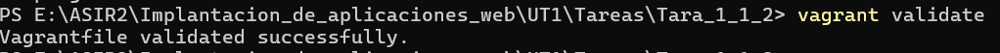
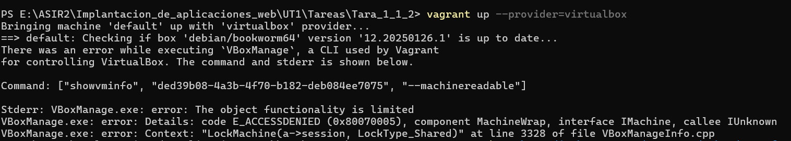
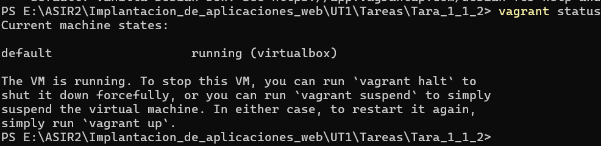
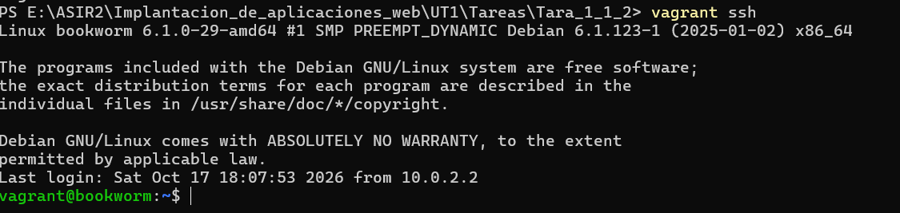
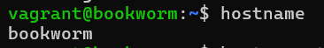
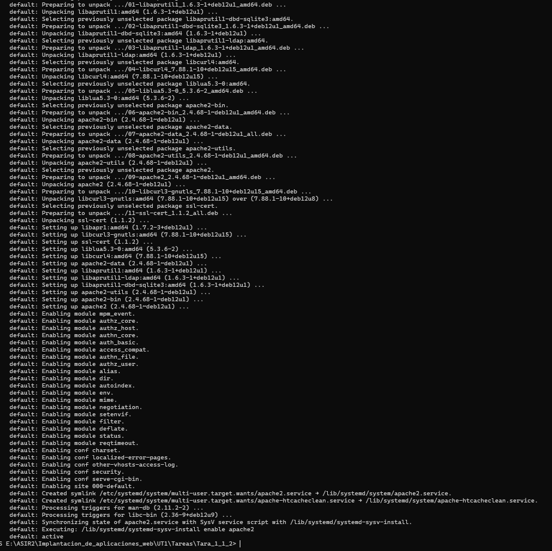
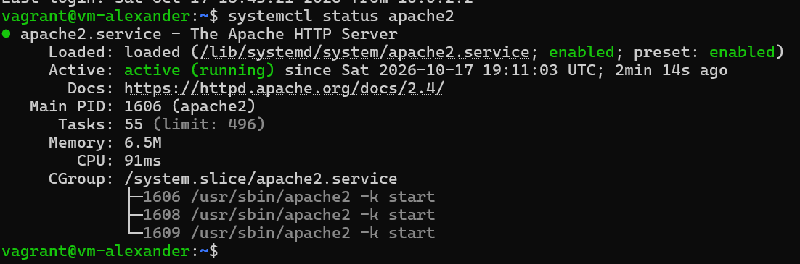
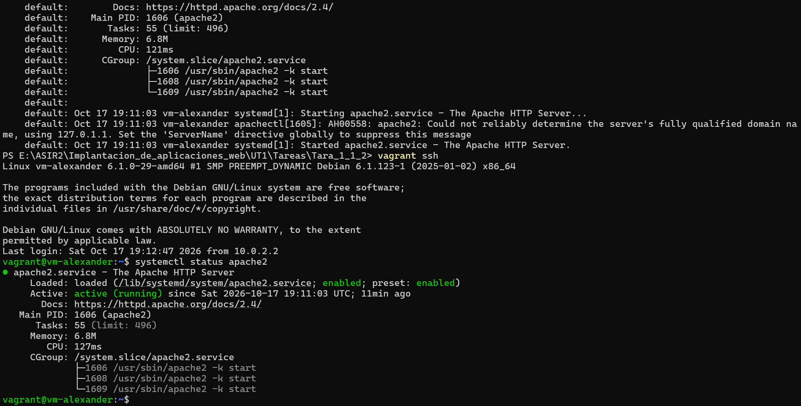

# Práctica de investigación: primeros pasos con Vagrant

## Datos de la práctica

- **Nombre y Apellidos:** Alexander Manuel Huaman Linares
- **Grupo:** ASIR 2
- **Título de la tarea:** Primeros pasos con Vagrant
- **Fecha:** 17/10/2026.

En esta práctica vamos a utilizar Vagrant para crear y configurar una máquina virtual con Debian 12.

El objetivo es aprender a preparar un entorno de trabajo que podamos volver a utilizar sin tener que configurar todo manualmente cada vez.

Para ello, utilizaremos Oracle VirtualBox. También configuraremos dos interfaces de red y un reenvío de puertos e instalaremos Apache mediante un script Bash.

Durante la práctica iremos comprobando que cada configuración funciona correctamente y documentaremos los resultados obtenidos.

---

# Parte A. Investiga antes de modificar el entorno

## 1. Vagrant y el Vagrantfile

### ¿Qué es Vagrant y qué problema resuelve?

Vagrant es una herramienta que permite crear, configurar y administrar máquinas virtuales mediante archivos de configuración y su principal ventaja es que podemos preparar un entorno de trabajo y reproducirlo en otros ordenadores sin tener que repetir todos los pasos manualmente.

Por ejemplo, si necesitamos una máquina Debian con Apache instalado y una configuración de red concreta, podemos definir todo eso mediante Vagrant.

De esta forma, otra persona puede utilizar los mismos archivos para crear un entorno similar en su ordenador.

También resulta útil cuando necesitamos eliminar una máquina virtual y volver a crearla desde cero para solucionar algún problema o realizar nuevas pruebas.

### Conceptos principales

**Anfitrión:**

Es el ordenador físico desde el que trabajamos y donde tenemos instalado Vagrant.

En mi caso, el anfitrión será mi ordenador con Windows.

**Proveedor de virtualización:**

Es el programa encargado de crear y ejecutar las máquinas virtuales.

Vagrant no realiza directamente la virtualización, sino que utiliza un proveedor como VirtualBox o VMware.

En esta práctica utilizaré Oracle VirtualBox.

**Box:**

Es una imagen base que Vagrant utiliza para crear una máquina virtual.

Una box puede incluir un sistema operativo ya preparado para trabajar con Vagrant.

En esta práctica utilizaremos una box de Debian 12 compatible con VirtualBox.

**Máquina virtual:**

Es un ordenador virtual que funciona dentro del equipo anfitrión.

Tiene su propio sistema operativo, memoria, almacenamiento e interfaces de red.

En nuestro caso, la máquina virtual utilizará Debian 12.

**Vagrantfile:**

Es el archivo donde se define la configuración de la máquina virtual.

En él podemos indicar qué box utilizar, el nombre de la máquina, las redes, los puertos y los scripts de aprovisionamiento.

### ¿En qué lenguaje está escrito el Vagrantfile?

El Vagrantfile está escrito en Ruby.

### Análisis del Vagrantfile inicial

He creado uno mediante el comando 
```powershell
vagrant init debian/bookworm64
```

Este comando genera un archivo de configuración básico que permite preparar una máquina virtual con Debian 12.

El archivo generado contiene varias líneas comentadas con `#`, que sirven como ejemplos y explicaciones de las opciones disponibles y solo hay tres líneas activas que forman la configuración inicial.

**Vagrantfile inicial (líneas activas):**

```ruby
Vagrant.configure("2") do |config|
  config.vm.box = "debian/bookworm64"
end
```

**Explicación:**

- `Vagrant.configure("2") do |config|`: inicia el bloque de configuración de Vagrant. El número `"2"` indica la versión de la sintaxis utilizada, mientras que `config` permite acceder a las opciones de configuración.

- `config.vm.box = "debian/bookworm64"`: indica que utilizaremos una box de Debian 12 (Bookworm) como sistema operativo de la máquina virtual.

- `end`: cierra el bloque de configuración iniciado con `Vagrant.configure`.

Por ahora, el archivo únicamente especifica la box que vamos a utilizar. No hemos configurado todavía el nombre de la máquina, una segunda interfaz de red, el reenvío de puertos ni el aprovisionamiento.

Estas configuraciones se añadirán luego en la Parte C.

### Análisis del Vagrantfile definitivo

El Vagrantfile definitivo, junto con la explicación de cada una de sus líneas activas y las comprobaciones realizadas, se encuentra más adelante, en la Parte C, apartado 7: «Vagrantfile definitivo y explicación».

En ese apartado explico qué configura cada línea, por qué la he añadido y cómo he comprobado su funcionamiento.

---

## 2. Aprovisionamiento

### ¿Qué es el aprovisionamiento?

El aprovisionamiento consiste en preparar automáticamente una máquina virtual para que tenga los programas y configuraciones que necesitamos.

Por ejemplo, en lugar de entrar en Debian e instalar Apache manualmente, podemos crear un script que realice la instalación.

Esto permite ahorrar tiempo y repetir la misma configuración cuando creamos una máquina nueva.

### ¿Qué es un provisioner?

Un provisioner es el mecanismo que utiliza Vagrant para realizar tareas de configuración dentro de la máquina virtual y existen diferentes tipos de provisioners.

En esta práctica utilizaremos uno de tipo Shell, que permite ejecutar comandos mediante un script Bash.

### ¿Dónde se ejecuta el script?

El script de aprovisionamiento se ejecuta dentro de la máquina virtual y Vagrant se encarga de enviar o ejecutar las instrucciones en Debian.

Por ejemplo, si el script contiene una orden para instalar Apache, el programa se instalará dentro de Debian 12.

### ¿Cuándo ejecuta Vagrant el aprovisionamiento?

Normalmente, Vagrant ejecuta el aprovisionamiento durante la primera creación de la máquina mediante:

```bash
vagrant up
```

De esta forma, la máquina se crea y después se realizan las tareas de configuración indicadas.

También podemos ejecutar el aprovisionamiento manualmente cuando lo necesitemos.

### Diferencia entre inline y path

Vagrant permite indicar los comandos de aprovisionamiento de dos formas.

**Inline:**

Permite escribir los comandos directamente dentro del Vagrantfile.

Ejemplo:

```ruby
config.vm.provision "shell", inline: "apt-get update"
```

Este ejemplo actualiza la lista de paquetes disponibles dentro de Debian.

**Path:**

Permite indicar la ubicación de un script externo.

Ejemplo:

```ruby
config.vm.provision "shell", path: "scripts/apache.sh"
```

En este caso, Vagrant utiliza el archivo `apache.sh`, que contiene los comandos necesarios.

La principal diferencia es que `inline` guarda los comandos dentro del Vagrantfile, mientras que `path` utiliza un archivo independiente.

Para esta práctica utilizaremos `path`, porque el script Bash estará guardado en el repositorio.

### ¿Qué ocurre si modificamos el script después del primer vagrant up?

Si modificamos el script después de haber creado la máquina, los cambios no se aplican automáticamente.

Esto ocurre porque el aprovisionamiento normalmente se ejecuta durante la primera creación de la máquina.

Para aplicar los cambios sin tener que eliminarla, utilizamos:

```bash
vagrant provision
```

Este comando vuelve a ejecutar los provisioners configurados.

También podemos reiniciar la máquina y ejecutar el aprovisionamiento con:

```bash
vagrant reload --provision
```

La diferencia es que `vagrant provision` ejecuta el aprovisionamiento sin reiniciar la máquina, mientras que `vagrant reload --provision` también la reinicia.

---

## 3. Interfaces y redes

### ¿Qué conexión de red configura Vagrant por defecto?

Normalmente, Vagrant configura una conexión NAT mediante el proveedor de virtualización.

En VirtualBox, esta conexión permite que la máquina virtual acceda a redes externas utilizando la conexión del anfitrión.

También facilita la comunicación que Vagrant necesita para administrar la máquina, por ejemplo, mediante SSH.

La dirección IP concreta dependerá del proveedor y de su configuración.

### ¿Qué es NAT?

NAT significa Network Address Translation, o traducción de direcciones de red, y permite que una máquina virtual utilice la conexión de red del anfitrión para comunicarse con el exterior.

Por ejemplo, una máquina Debian conectada mediante NAT puede descargar paquetes de Internet para instalar programas.

Sin embargo, los dispositivos externos normalmente no pueden iniciar conexiones directamente hacia la máquina virtual sin configurar algún mecanismo adicional.

En VirtualBox, el modo NAT es una opción habitual para proporcionar conectividad externa a las máquinas virtuales.

### ¿Qué es una red interna?

Una red interna permite que varias máquinas virtuales se comuniquen entre sí cuando están conectadas a la misma red interna.

En VirtualBox, este tipo de red mantiene las máquinas aisladas del anfitrión y de la red física.

Por ejemplo, podríamos conectar dos máquinas virtuales a una misma red interna para realizar prácticas de comunicación entre ellas.

Las máquinas deben utilizar el mismo nombre de red interna para poder comunicarse mediante esa red.

En esta práctica utilizaremos una red interna de VirtualBox para la segunda interfaz de Debian.

La red interna no proporciona acceso directo a Internet por sí sola, pero nuestra máquina mantendrá la interfaz NAT para disponer de conectividad externa.

### ¿Qué es una red privada host-only?

Una red host-only permite la comunicación entre el anfitrión y las máquinas virtuales conectadas a esa red.

También permite que varias máquinas virtuales de la misma red host-only se comuniquen entre sí.

A diferencia de una red interna de VirtualBox, el anfitrión sí puede participar directamente en la comunicación.

Por sí sola, esta red no proporciona acceso directo a Internet.

Aunque VirtualBox también dispone de redes host-only, en esta práctica utilizaremos una red interna para cumplir la configuración solicitada.

### ¿Qué es una red pública?

Una red pública en Vagrant normalmente se configura mediante una conexión de tipo puente.

Esta modalidad conecta la máquina virtual con la red física del anfitrión.

Por ejemplo, si nuestro ordenador está conectado a una red local, la máquina virtual puede aparecer como otro equipo dentro de esa red.

La comunicación dependerá de la configuración de la red y de las restricciones existentes.

### Comparación de redes

| Tipo de red | Comunicación principal | Acceso al anfitrión | Acceso a Internet |
|---|---|---|---|
| NAT | Salida a otras redes mediante el anfitrión | Mediante las conexiones permitidas por NAT | Normalmente sí |
| Interna | Entre máquinas de la misma red interna | No directamente | No por sí sola |
| Host-only | Anfitrión y máquinas de la misma red privada | Sí | No por sí sola |
| Pública / puente | Con dispositivos de la red física | Según la red | Depende de la red |

### ¿Cómo se añade una segunda interfaz con IP fija?

Vagrant permite configurar una segunda interfaz mediante el Vagrantfile.

Una configuración habitual para una red privada sería:

```ruby
config.vm.network "private_network", ip: "192.168.56.10"
```

Esta línea indica que queremos utilizar una red privada y asignar una dirección IP fija a la máquina virtual.

Sin embargo, en VirtualBox, una red privada configurada de esta forma normalmente utiliza una red host-only.

Como en nuestra práctica necesitamos una red interna, tendremos que indicar también el tipo de interfaz correspondiente al proveedor VirtualBox.

Por ejemplo:

```ruby
config.vm.network "private_network",
  ip: "192.168.100.10",
  virtualbox__intnet: "red-interna-asir"
```

En este ejemplo:

- `private_network` añade una segunda interfaz de red.
- `ip` asigna una dirección IP fija a Debian.
- `virtualbox__intnet` indica que VirtualBox debe utilizar una red interna.
- `"red-interna-asir"` identifica el nombre de esa red interna.

La dirección `192.168.100.10` es únicamente un ejemplo. Antes de utilizarla comprobaremos que no exista un conflicto con otras redes del equipo.

La configuración definitiva se realizará en la Parte C.

### Diferencia entre red interna y host-only de VirtualBox

Aunque ambas permiten crear redes de laboratorio, no funcionan exactamente igual.

En una red interna de VirtualBox, las máquinas virtuales pueden comunicarse entre ellas, pero el anfitrión no participa directamente en esa red.

En cambio, en una red host-only de VirtualBox, el anfitrión también tiene conectividad con las máquinas virtuales conectadas a esa red.

Por eso, no debemos considerar que ambas modalidades son exactamente iguales.

En nuestro caso, como utilizaremos VirtualBox y necesitamos una red interna, la segunda interfaz será de tipo Internal Network.

### ¿Añadir una segunda interfaz elimina la NAT predeterminada?

No. Cuando añadimos una segunda interfaz de red, la NAT que utiliza Vagrant por defecto se mantiene.

Por tanto, nuestra máquina tendrá dos conexiones:

1. Una interfaz NAT para la comunicación externa y la administración de Vagrant.
2. Una interfaz de red interna con IP fija para la red de laboratorio.

Esto permite utilizar ambas redes con funciones diferentes.

### ¿Qué es el reenvío de puertos?

El reenvío de puertos permite acceder a un servicio de la máquina virtual utilizando un puerto del anfitrión.

Por ejemplo, si Apache utiliza el puerto 80 dentro de Debian, podemos configurar que el puerto 8080 de Windows redirija las conexiones hacia ese servicio.

En esta práctica utilizaremos:

- Puerto del anfitrión: 8080.
- Puerto de Debian: 80.
- Dirección de escucha del anfitrión: 127.0.0.1.

De esta manera, podremos acceder al servidor Apache desde el navegador del anfitrión mediante:

```text
http://127.0.0.1:8080
```

La dirección `127.0.0.1` corresponde a localhost, es decir, al propio equipo.

Limitar el reenvío a esta dirección evita que el puerto quede expuesto directamente a otros dispositivos de la red.

En VirtualBox, el reenvío se realizará mediante la interfaz NAT, sin necesidad de que Windows participe en la red interna.

### ¿El reenvío de puertos crea una interfaz nueva?

No. El reenvío de puertos únicamente redirige las conexiones de un puerto hacia otro.

No añade una tarjeta de red ni crea una nueva interfaz dentro de Debian.

Por tanto, la máquina seguirá teniendo las dos interfaces que configuraremos: NAT y red interna.

### Arquitectura de red 
```text
Windows (anfitrión)
        |
     VirtualBox
        |
 Debian 12: vm-alexander
        |
   +----+----------------+
   |                     |
 eth0 NAT             eth1 Interna
 10.0.2.15/24         192.168.56.10/24
 Puerta: 10.0.2.2     red-interna-asir
   |
 Internet
```

Reenvío:
127.0.0.1:8080 → Debian:80

Este esquema representa la arquitectura de red utilizada en la práctica

---

## 4. Órdenes y carpeta compartida

### Comandos principales de Vagrant

| Comando | ¿Para qué sirve? | ¿Ejecutado? |
|---|---|---|
| `vagrant up` | Crea y arranca la máquina virtual. | Si |
| `vagrant status` | Muestra el estado de la máquina virtual. | Si |
| `vagrant ssh` | Permite acceder a la máquina mediante SSH. | Si |
| `vagrant reload` | Reinicia la máquina y aplica cambios de configuración. | Si |
| `vagrant provision` | Vuelve a ejecutar el aprovisionamiento. | Si |
| `vagrant halt` | Apaga la máquina virtual. | Si |
| `vagrant destroy` | Elimina la máquina virtual administrada por Vagrant. | No |

No es necesario eliminar la máquina únicamente para marcar `vagrant destroy` como ejecutado. Si no se utiliza, se puede indicar que no ha sido necesario.

### ¿Qué es la carpeta /vagrant?

Vagrant normalmente configura una carpeta compartida entre el anfitrión y la máquina virtual.

Esta carpeta permite acceder desde Debian a los archivos del proyecto que tenemos en Windows.

Dentro de la máquina virtual suele aparecer en la ruta:

```text
/vagrant
```

Por ejemplo, si en Windows tenemos una carpeta con el Vagrantfile, el README y los scripts, podremos acceder a esos archivos desde Debian a través de `/vagrant`, siempre que la carpeta compartida esté correctamente configurada.

Esto resulta útil porque podemos modificar los archivos desde Windows y utilizarlos dentro de la máquina virtual.

En VirtualBox, el funcionamiento de las carpetas compartidas puede depender de la compatibilidad de las Guest Additions instaladas en Debian.

### Comprobación de la carpeta compartida

Para comprobar qué archivos aparecen, primero accederemos a Debian:

```bash
vagrant ssh
```

Después ejecutaremos:

```bash
ls -la /vagrant
```

Este comando muestra los archivos y carpetas que existen dentro de `/vagrant`, incluyendo los ocultos.

Para realizar esta comprobación, primero he completado el arranque y el acceso a Debian de la Parte B, ya que necesitaba tener la máquina virtual funcionando para utilizar `vagrant ssh`.

Una vez dentro de Debian, he ejecutado el comando `ls -la /vagrant` para comprobar qué archivos de mi proyecto de Windows aparecen en la carpeta compartida.

**Captura:**


**Resultado:**

Al ejecutar `ls -la /vagrant`, he comprobado que Debian puede acceder a los archivos de mi proyecto de Windows.

- `.vagrant/`: información interna de Vagrant.
- `README.md`: documentación de la práctica.
- `Vagrant.pdf`: instrucciones del profesor.
- `Vagrantfile`: configuración de la máquina virtual.
- `Vagrantfile.bak`: copia de seguridad.
- `images/`: capturas de pantalla.
- `scripts/`: scripts de aprovisionamiento.

También aparecen `.` y `..`, que representan la carpeta actual y la superior.

**Conclusión:** la carpeta compartida `/vagrant` funciona correctamente y permite acceder a los archivos del proyecto desde Debian.

---

# Parte B. Mi primera máquina en Vagrant

## 1. Preparación del entorno

Para realizar esta práctica utilizaré:

- Sistema anfitrión: Windows.
- Herramienta de administración: Vagrant.
- Proveedor de virtualización: Oracle VirtualBox.
- Sistema operativo invitado: Debian 12.

Antes de empezar, comprobaré que Vagrant y VirtualBox están correctamente instalados y que Vagrant puede utilizar el proveedor VirtualBox.

### Comprobación de Vagrant

Desde PowerShell:

```powershell
vagrant --version
```

**Resultado:**

```text
Vagrant 2.4.9
```

Esta es la versión de Vagrant que tengo instalada en Windows.

### Comprobación de VirtualBox

Para comprobar que VirtualBox está instalado y que su herramienta de línea de comandos funciona, utilizaré:

```powershell
VBoxManage.exe --version
```

Este comando permite consultar la versión de VirtualBox instalada.

**Resultado:**

```powershell
7.2.4r170995
```

### Comprobación del proveedor VirtualBox

Vagrant incluye soporte para VirtualBox, por lo que no necesitariamos instalar ningun plugin, (si usaramos VMware, si necesitariamos un plugin especial).

Podemos consultar los plugins adicionales instalados mediante:

```powershell
vagrant plugin list
```

## 2. Validación del Vagrantfile inicial

Antes de modificar el archivo proporcionado, comprobaré que su configuración sea válida.

Desde la carpeta del proyecto:

```powershell
vagrant validate
```

Este comando comprueba la sintaxis y la estructura del Vagrantfile, aunque no garantiza que toda la configuración vaya a funcionar al arrancar la máquina.

**Resultado:**

Vagrantfile validated successfully.

**Captura:**



## 3. Arranque de la máquina virtual

Para arrancar la máquina con Oracle VirtualBox utilizaré:

```powershell
vagrant up --provider=virtualbox
```

Este comando solicita a Vagrant que cree o arranque la máquina utilizando VirtualBox como proveedor.

Si la box todavía no está descargada, Vagrant puede necesitar descargarla antes de crear la máquina.

La box elegida debe tener una versión compatible con VirtualBox.

**Resultado:**


- La box `debian/bookworm64` se descargó correctamente.
- VirtualBox comenzó a crear la máquina virtual.

**Error durante el arranque:**

Durante la creación de la máquina virtual apareció el error `E_ACCESSDENIED (0x80070005)`, cuando VirtualBox intentó consultar su información. Esto impidió completar el arranque de Debian 12.

**Solución:**

Para investigar el problema, ejecuté `VBoxManage.exe list vms` y comprobé que tenía varias máquinas virtuales antiguas que aparecían como `<inaccessible>` porque sus archivos de configuración ya no estaban disponibles en las rutas registradas.

Después de identificar sus UUID, eliminé los registros de esas máquinas de VirtualBox mediante el comando `VBoxManage.exe unregistervm`, sin utilizar `--delete` para no borrar sus archivos.

Finalmente, volví a ejecutar `vagrant up --provider=virtualbox` y esta vez la máquina virtual Debian 12 arrancó correctamente.


**Captura del error:**



Luego de solucionar el error, la maquina arranco correctamente.

**Captura:**


## 4. Comprobación del estado

Después del arranque consulte el estado de la máquina:

```powershell
vagrant status
```

**Resultado:**



Si aparece `running`, significa que la máquina virtual está encendida.

## 5. Acceso a Debian mediante SSH

Para entrar en la máquina utilizaré:

```powershell
vagrant ssh
```

Este comando permite acceder a la terminal de Debian utilizando la configuración SSH administrada por Vagrant.

**Resultado:**



**Error durante el proceso:**

Al principio, tenía el proyecto guardado en la unidad E:, que utiliza el sistema de archivos exFAT. Cuando intenté acceder a Debian mediante `vagrant ssh`, apareció el error `Permission denied (publickey)` porque la clave privada SSH no tenía los permisos de seguridad necesarios.

Como solución temporal, copié la clave privada a C: y añadí esta línea al Vagrantfile:

```ruby
config.ssh.private_key_path = "C:/Users/alexa/.ssh/vagrant-asir2"
```

Con esto conseguí acceder a Debian y continuar con la práctica.

Sin embargo, al preparar el proyecto para GitHub, me di cuenta de que esa configuración dependía de una ruta personal y no sería adecuada para otros equipos.

Por eso, trasladé el proyecto a `C:\ASIR2\Tara_1_1_2`, eliminé la línea anterior y creé una máquina virtual nueva. Esta vez pude acceder mediante `vagrant ssh` sin configurar manualmente ninguna clave privada.

De esta manera, solucioné el problema y dejé el proyecto preparado para que otra persona pueda reproducirlo.

## 6. Comprobación del nombre de la máquina

Dentro de Debian ejecuté:

```bash
hostname
```

**Hostname obtenido:**



## 7. Comprobación de la versión de Debian

Para conocer la versión del sistema operativo ejecuté:

```bash
cat /etc/os-release
```

**Versión obtenida:**

```text
PRETTY_NAME="Debian GNU/Linux 12 (bookworm)"
NAME="Debian GNU/Linux"
VERSION_ID="12"
VERSION="12 (bookworm)"
VERSION_CODENAME=bookworm
ID=debian
HOME_URL="https://www.debian.org/"
SUPPORT_URL="https://www.debian.org/support"
BUG_REPORT_URL="https://bugs.debian.org/"
```

## 8. Comprobación de las interfaces de red

Para consultar las interfaces y direcciones IP ejecuté:

```bash
ip a
```

**Resultado:**

```text
vagrant@bookworm:~$ ip a
1: lo: <LOOPBACK,UP,LOWER_UP> mtu 65536 qdisc noqueue state UNKNOWN group default qlen 1000
    link/loopback 00:00:00:00:00:00 brd 00:00:00:00:00:00
    inet 127.0.0.1/8 scope host lo
       valid_lft forever preferred_lft forever
    inet6 ::1/128 scope host noprefixroute
       valid_lft forever preferred_lft forever
2: eth0: <BROADCAST,MULTICAST,UP,LOWER_UP> mtu 1500 qdisc fq_codel state UP group default qlen 1000
    link/ether 08:00:27:8d:c0:4d brd ff:ff:ff:ff:ff:ff
    altname enp0s3
    inet 10.0.2.15/24 brd 10.0.2.255 scope global dynamic eth0
       valid_lft 84833sec preferred_lft 84833sec
    inet6 fd17:625c:f037:2:a00:27ff:fe8d:c04d/64 scope global dynamic mngtmpaddr
       valid_lft 86207sec preferred_lft 14207sec
    inet6 fe80::a00:27ff:fe8d:c04d/64 scope link
       valid_lft forever preferred_lft forever
vagrant@bookworm:~$

```

## 9. Comprobación de las rutas de red

Para consultar la tabla de rutas ejecuté:

```bash
ip route
```

Este comando permitirá identificar la ruta predeterminada y las redes a las que está conectada la máquina.

**Resultado:**

```text
default via 10.0.2.2 dev eth0
10.0.2.0/24 dev eth0 proto kernel scope link src 10.0.2.15
```

---

# Parte C. Completa el Vagrantfile

## 1. Objetivo

En esta parte modificaré el Vagrantfile inicial para crear una máquina Debian 12 con la configuración solicitada.

La máquina tendrá:

- Debian 12.
- Un hostname identificable con mi nombre.
- Una interfaz NAT predeterminada.
- Una segunda interfaz de red interna de VirtualBox con IP fija.
- Reenvío del puerto 8080 del anfitrión al puerto 80 de Debian.
- Un script Bash de aprovisionamiento externo.

## 2. Configuración del hostname

El hostname permite identificar una máquina dentro del sistema y en esta práctica utilizaré un nombre relacionado con mi nombre.

**Hostname elegido:**

```text
vm-alexander
```

**Línea agregada a el Vagrantfile:**

```ruby
# Hostname identificable con un nombre
config.vm.hostname = "vm-alexander"
```

**Comprobación:**
Para que los cambios hagan efecto, he ejecutado en mi maquina anfitrion esto: `vagrant reload` y luego he vuelto a ingresar a la maquina con `vagrant ssh` y ejecute esto: 

```bash
hostname
```

**Resultado:**


## 3. Primera interfaz: NAT

Mantendré la conexión NAT que Vagrant configura por defecto mediante VirtualBox.

Esta interfaz permite que Debian tenga conectividad externa y que Vagrant pueda administrar la máquina mediante SSH.

Como ya he comprobado las interfaces y las rutas de red en los apartados 8 y 9 de la Parte B, utilizaré esos resultados para identificar la configuración NAT.

**Interfaz NAT:**

`eth0` (también identificada como `enp0s3`).

**Dirección IP:**

`10.0.2.15/24`

**Puerta de enlace:**

`10.0.2.2`

**Ruta predeterminada:**

```text
default via 10.0.2.2 dev eth0
```

Esta ruta indica que Debian envía el tráfico destinado a otras redes a través de la puerta de enlace `10.0.2.2`, utilizando la interfaz `eth0`.

Además, la ruta `10.0.2.0/24 dev eth0` identifica la red a la que está conectada directamente esta interfaz.

Por tanto, he comprobado que la máquina tiene configurada la interfaz NAT predeterminada de VirtualBox.

## 4. Segunda interfaz: red interna

La segunda interfaz será una red interna de Oracle VirtualBox.

Esta red permitirá que Debian se comunique con otras máquinas virtuales conectadas a la misma red interna, sin que el anfitrión participe directamente en ella.

**Nombre de la red interna:**

`red-interna-asir`

**Red de laboratorio:**

`192.168.56.0/24`

**Interfaz utilizada:**

`eth1` (también identificada como `enp0s8`).

**Dirección IP fija:**

`192.168.56.10`

**Máscara de red:**

`255.255.255.0`

**Configuración añadida a el Vagrantfile:**

```ruby
config.vm.network "private_network", ip: "192.168.56.10", netmask: "255.255.255.0", virtualbox__intnet: "red-interna-asir"
```

Esta configuración añade una segunda interfaz con una IP fija y la conecta a una red interna de VirtualBox, manteniendo la NAT como primera interfaz.

**Comprobación:**


También comprobe que la ruta predeterminada continúa utilizando la interfaz NAT.


## 5. Reenvío de puertos

Para acceder al servidor Apache desde Windows he configurado un reenvío de puertos mediante VirtualBox.

La configuración está limitada a la dirección `127.0.0.1`, que corresponde al propio ordenador anfitrión.

De esta manera, podré acceder al servidor Apache desde Windows sin exponer el puerto reenviado directamente a otros dispositivos de la red.

**Configuración utilizada:**

```ruby
config.vm.network "forwarded_port", guest: 80, host: 8080, host_ip: "127.0.0.1"
```

Esta línea indica que las conexiones realizadas al puerto 8080 de Windows serán redirigidas al puerto 80 de Debian, donde funcionará Apache.

**Puerto del anfitrión:**

`8080`

Antes de configurar el reenvío, he comprobado mediante PowerShell que el puerto 8080 estaba disponible.

```powershell
Get-NetTCPConnection -LocalPort 8080 -State Listen -ErrorAction SilentlyContinue
```

El comando no mostró ningún proceso escuchando en ese puerto, por lo que pude utilizarlo para la práctica.

**Puerto de Debian:**

`80`

Después de modificar el Vagrantfile, he ejecutado `vagrant reload` para reiniciar la máquina y aplicar la configuración.


## 6. Vinculación del script de aprovisionamiento

Para instalar y configurar Apache automáticamente, crearé un script Bash que guardaré dentro de la carpeta `scripts` de mi proyecto.

El script se llamará `apache.sh` y contendrá los comandos necesarios para actualizar los paquetes, instalar Apache, activar el servicio y crear una página de inicio con mi nombre y el hostname de Debian.

**Ruta del script:**

```text
./scripts/apache.sh
```

**Configuración agredada a el Vagrantfile:**

```ruby
config.vm.provision "shell", path: "scripts/apache.sh"
```

Esta línea indica a Vagrant que debe ejecutar el script Bash dentro de Debian durante el aprovisionamiento.

De esta manera, no tendré que instalar ni configurar Apache manualmente cada vez que cree la máquina virtual.

El script estará separado del Vagrantfile y se incluirá en el repositorio de GitHub junto con los demás archivos de la práctica.


## 7. Vagrantfile definitivo y explicación

Después de realizar las modificaciones anteriores, el Vagrantfile queda configurado para crear una máquina Debian 12 con un hostname personalizado, dos interfaces de red, un reenvío de puertos y un script de aprovisionamiento.

**Vagrantfile definitivo (líneas activas):**

```ruby
Vagrant.configure("2") do |config|
  config.vm.box = "debian/bookworm64"
  config.vm.hostname = "vm-alexander"
  config.vm.network "forwarded_port", guest: 80, host: 8080, host_ip: "127.0.0.1"
  config.vm.network "private_network", ip: "192.168.56.10", netmask: "255.255.255.0", virtualbox__intnet: "red-interna-asir"
  config.vm.provision "shell", path: "scripts/apache.sh"
end
```

**Explicación de las líneas activas:**

- `Vagrant.configure("2") do |config|`: inicia la configuración del Vagrantfile utilizando la versión 2 de su sintaxis.

- `config.vm.box`: selecciona la box `debian/bookworm64` para utilizar Debian 12. Comprobé la versión del sistema mediante `cat /etc/os-release`.

- `config.vm.hostname`: establece el nombre `vm-alexander`, que elegí para identificar la máquina con mi nombre. Comprobé el cambio mediante `hostname`, después de ejecutar `vagrant reload`.

- `config.vm.network "forwarded_port"`: redirige el puerto 8080 de Windows al puerto 80 de Debian y limita el acceso a `127.0.0.1`. Esto permitirá acceder al servidor Apache desde el anfitrión.

- `config.vm.network "private_network"`: añade una segunda interfaz con la IP fija `192.168.56.10/24`, conectada a la red interna `red-interna-asir` de VirtualBox. Comprobé mediante `ip a` que Debian reconocía la interfaz `eth1` con esa dirección, manteniendo `eth0` para NAT.

- `config.vm.provision "shell"`: vincula el script `scripts/apache.sh` para instalar y configurar Apache automáticamente.

- `end`: cierra el bloque de configuración del Vagrantfile.

**Comprobación de la configuración:**

Para validar el archivo he utilizado:

```powershell
vagrant validate
```

Después de modificar las opciones de red y el hostname, he aplicado los cambios mediante:

```powershell
vagrant reload
```

---

# Parte D. Aprovisiona Apache

## 1. Objetivo

En esta parte crearé un script Bash para instalar y configurar Apache automáticamente dentro de Debian 12.

El script deberá:

1. Actualizar la información de los paquetes.
2. Instalar Apache.
3. Activar el servicio.
4. Iniciar el servicio.
5. Crear una página de inicio.
6. Mostrar mi nombre y el hostname de la máquina.

De esta forma, al ejecutar el aprovisionamiento, Debian quedará preparado para funcionar como servidor web.

## 2. Creación del script Bash

Para instalar y configurar Apache automáticamente, crearé un archivo Bash llamado `apache.sh` dentro de la carpeta `scripts` de mi proyecto.

**Ruta del archivo:**

```text
./scripts/apache.sh
```

El script contendrá los comandos necesarios para instalar Apache, activar e iniciar el servicio y generar una página web que muestre mi nombre y el hostname de Debian.

El código se desarrollará directamente en el archivo `apache.sh` y cada linea ira comentada para que sirve cada linea del script.

## 3. Ejecución del aprovisionamiento

Una vez configurado el script en el Vagrantfile, el aprovisionamiento se ejecutará durante la creación inicial de la máquina.

Si la máquina ya existe, podré ejecutarlo manualmente:

```powershell
vagrant provision
```

**Resultado:**



## 4. Comprobación del servicio Apache

Dentro de Debian comprobaré el estado del servicio mediante:

```bash
systemctl status apache2
```

Si el servicio está funcionando, este comando debería mostrar:

```text
 Loaded: loaded (/lib/systemd/system/apache2.service; enabled; preset: enabled)
     Active: active (running) 
```

**Resultado:**



## 5. Comprobación de la página desde Debian

Para comprobar que Apache responde dentro de la máquina virtual utilizaré:

```bash
curl http://127.0.0.1
```

Este comando realiza una petición HTTP al servidor web local.

La respuesta debería contener el HTML de la página creada por el script.

**Incidencia durante la comprobación:**

Al ejecutar `curl`, Debian mostró el mensaje `command not found`, porque la herramienta no estaba instalada.

Para solucionarlo, ejecuté:

```bash
sudo apt install curl
```

Después repetí la petición HTTP y Apache respondió mostrando mi nombre, el hostname `vm-alexander` y el mensaje de la segunda prueba de aprovisionamiento.

Esto confirmó que el servidor web funcionaba correctamente dentro de Debian.

**Resultado:**


## 6. Comprobación desde el anfitrión

Después comprobaré que el reenvío de puertos funciona correctamente.

Desde el navegador de Windows accederé a:

```text
http://127.0.0.1:8080
```

Si el reenvío funciona, debería aparecer la página de Apache creada mediante el script.

**Resultado:**


## 7. Modificación y nueva ejecución del aprovisionamiento

Después de ejecutar el aprovisionamiento por primera vez, he modificado el script `apache.sh` para comprobar que Vagrant permite aplicar cambios sin necesidad de eliminar ni volver a crear la máquina virtual.

**Cambio realizado en el script:**

He añadido una nueva línea para mostrar un mensaje adicional en la página principal de Apache:

```bash
echo "<p>Segunda prueba de aprovisionamiento con Vagrant</p>" >> /var/www/html/index.html
```

Esta instrucción utiliza `echo` para escribir un mensaje HTML y el operador `>>` para añadirlo al final del archivo `index.html`, sin eliminar el contenido anterior.

De esta manera, podré comprobar fácilmente si el script se ha ejecutado de nuevo, porque aparecerá un texto que no estaba en la primera versión de la página.

**Segunda ejecución del aprovisionamiento:**

Después de guardar los cambios, desde PowerShell he ejecutado:

```powershell
vagrant provision
```

Este comando vuelve a ejecutar el script Bash dentro de Debian, sin necesidad de recrear la máquina virtual.

**Resultado de la segunda ejecución:**


**Comprobación del servicio Apache:**

Después accederé a Debian mediante `vagrant ssh` y comprobaré el servicio con:

```bash
systemctl status apache2
```



**Comprobación final desde Windows:**

Por último, accederé desde el navegador del anfitrión a:

```text
http://127.0.0.1:8080
```

**Captura:**


Finalmente, comprobé que Apache seguía funcionando y que los cambios realizados en el script se habían aplicado correctamente. Aunque durante la práctica aparecieron algunos errores, pude solucionarlos y completar las comprobaciones.

---

# Fuentes de consulta

Durante la práctica he consultado la documentación oficial de Vagrant y VirtualBox. También he utilizado ChatGPT para entender mejor algunos comandos y solucionar los errores que iban apareciendo.

| Fecha | Fuente | ¿Para qué la utilicé? |
|---|---|---|
| 16/10/2026  | [Vagrant y Vagrantfile](https://developer.hashicorp.com/vagrant/docs/vagrantfile) | Para entender qué es Vagrant y cómo configurarlo. |
| 16/10/2026  | [Redes de Vagrant](https://developer.hashicorp.com/vagrant/docs/networking) | Para comprender NAT, red interna y host-only. |
| 17/10/2026  | [VirtualBox](https://www.virtualbox.org/manual/) | Para consultar la configuración de las máquinas y sus redes. |
| 17/10/2026 | [Puertos y aprovisionamiento](https://developer.hashicorp.com/vagrant/docs/networking/forwarded_ports) | Para configurar el reenvío de puertos. |
| 17/10/2026 | [Aprovisionamiento Shell](https://developer.hashicorp.com/vagrant/docs/provisioning/shell) | Para crear y ejecutar el script de Apache. |
| 16–17/10/2026 | Chat GPT | Para comprender mejor la documentación, los comandos y los errores. |
| Durante la práctica | Material del profesor | Para seguir las instrucciones de la tarea. |
