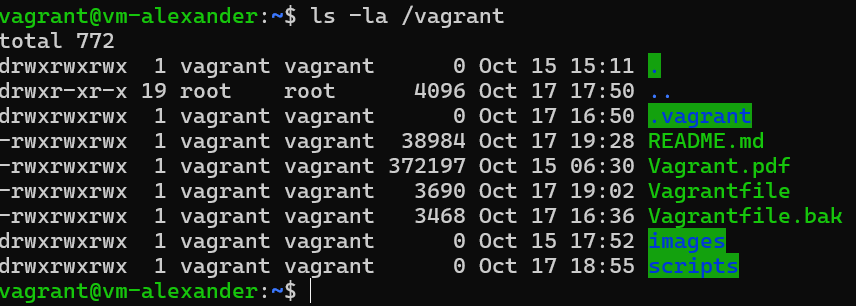
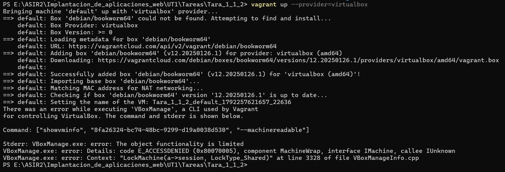
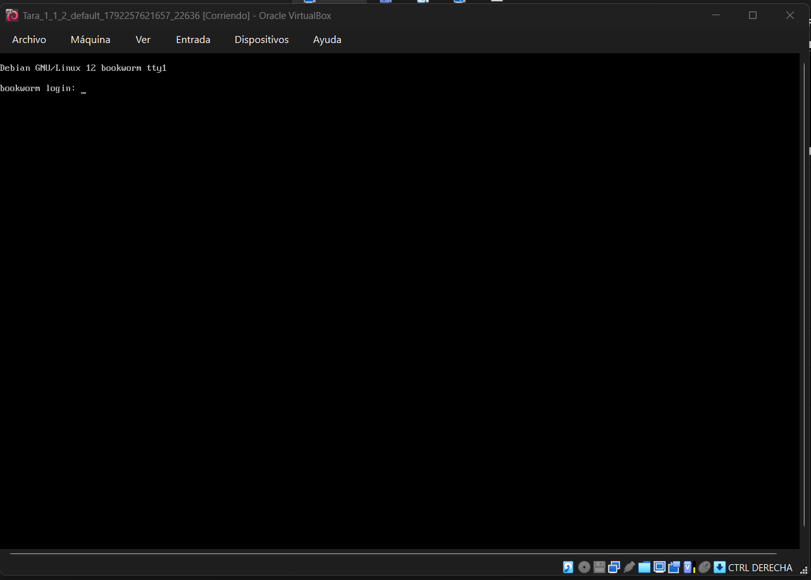
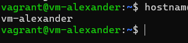
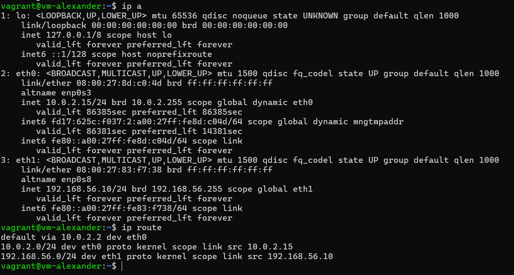
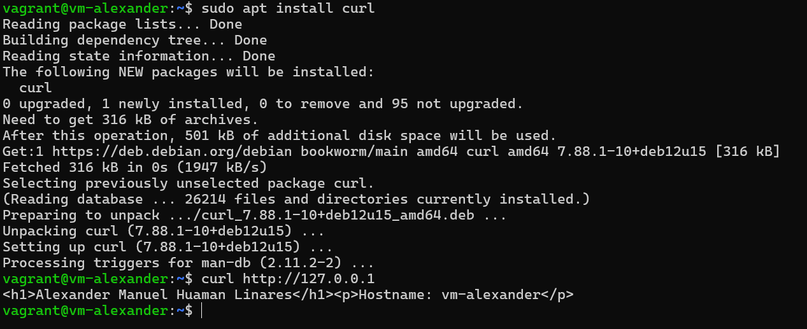
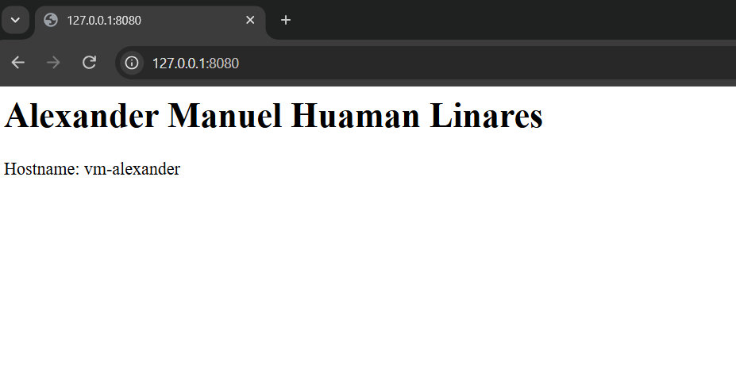
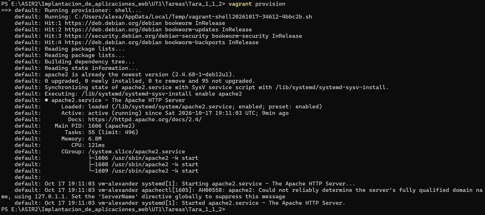
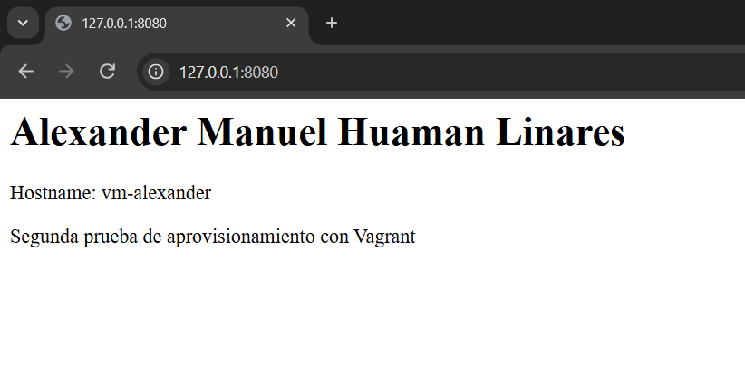

# Práctica de investigación: primeros pasos con Vagrant

## Datos de la práctica

- **Nombre y Apellidos:** Alexander Manuel Huaman Linares
- **Grupo:** ASIR 2
- **Título de la tarea:** Primeros pasos con Vagrant
- **Fecha:** 17/10/2026.

En esta práctica he utilizado Vagrant y VirtualBox para crear una máquina virtual con Debian 12. El objetivo ha sido configurar el sistema desde un Vagrantfile, sin depender de una instalación manual cada vez que necesite volver a utilizarlo. Para ello preparé dos interfaces de red, el acceso a Apache desde Windows y un script de aprovisionamiento. También fui comprobando cada parte y anotando los errores que encontré.

---

# Parte A. Investiga antes de modificar el entorno

## 1. Vagrant y el Vagrantfile

### ¿Qué es Vagrant y qué problema resuelve?

Vagrant es una herramienta para crear y administrar máquinas virtuales mediante archivos de configuración. Su principal ventaja es que permite repetir un mismo entorno sin tener que instalar el sistema y configurar todos sus servicios a mano. Por ejemplo, si elimino la máquina de esta práctica, puedo volver a crear Debian 12 con las redes y Apache usando el mismo proyecto. Esto también facilita que otra persona pueda reproducir la práctica en su ordenador, siempre que tenga instalados Vagrant y VirtualBox.

### Conceptos principales

**Anfitrión:** es el ordenador físico desde el que se ejecutan las máquinas virtuales. En mi caso, es mi equipo con Windows, donde he instalado Vagrant y VirtualBox.

**Proveedor de virtualización:** es el programa que se encarga de crear y ejecutar la máquina virtual. Vagrant se comunica con ese programa para realizar acciones como arrancar, detener o configurar la máquina. He utilizado Oracle VirtualBox.

**Box:** es una imagen base que Vagrant utiliza para crear una máquina virtual. Normalmente ya incluye un sistema operativo preparado. Para esta práctica he utilizado `debian/bookworm64`, correspondiente a Debian 12 (Bookworm).

**Máquina virtual:** es un equipo creado mediante software que utiliza recursos del anfitrión, pero funciona con su propio sistema operativo, disco virtual y adaptadores de red. En esta práctica la máquina virtual ejecuta Debian 12.

**Vagrantfile:** es el archivo principal del proyecto. Contiene las opciones que Vagrant necesita para preparar la máquina: la box, el hostname, las redes, el reenvío de puertos y el script de aprovisionamiento. Está escrito en Ruby.

### ¿En qué lenguaje está escrito el Vagrantfile?

El Vagrantfile está escrito en **Ruby**.

### Análisis del Vagrantfile inicial

Primero generé el archivo básico con este comando:

```powershell
vagrant init debian/bookworm64
```

El archivo incluía varias opciones de ejemplo comentadas con `#`. La configuración activa inicial era:

```ruby
Vagrant.configure("2") do |config|
  config.vm.box = "debian/bookworm64"
end
```

El bloque comienza con `Vagrant.configure("2") do |config|`. El número 2 indica la versión de la sintaxis de Vagrant y `config` permite establecer las opciones. La línea `config.vm.box` selecciona Debian 12, mientras que `end` cierra el bloque. Los comentarios del archivo inicial son ejemplos que no se ejecutan. Todavía faltaban el hostname, la segunda interfaz, el reenvío de puertos y el script, que añadí en la Parte C.

### Análisis del Vagrantfile definitivo

El archivo final y la explicación de sus líneas están en la **Parte C, apartado 7**, después de los cambios que fui realizando.

---

## 2. Aprovisionamiento

### ¿Qué es el aprovisionamiento?

El aprovisionamiento consiste en preparar automáticamente una máquina virtual después de crearla. Puede utilizarse para instalar programas, activar servicios o crear archivos. En esta práctica lo he utilizado para instalar Apache, arrancarlo y generar una página web con mi nombre y el hostname. Así no tengo que repetir esos pasos manualmente al crear otra máquina.

### ¿Qué es un provisioner?

Un *provisioner* es el mecanismo con el que Vagrant ejecuta las tareas de preparación. Hay varios tipos, pero aquí he utilizado **Shell**, porque permite indicar comandos de Bash mediante un archivo `.sh`. Ese archivo contiene las órdenes que Debian ejecuta durante la instalación de Apache.

### ¿Dónde se ejecuta el script?

El script se ejecuta dentro de Debian, aunque esté guardado en una carpeta de mi proyecto de Windows. Vagrant se encarga de utilizarlo durante el aprovisionamiento. Por eso los paquetes y servicios que instala pertenecen a la máquina virtual, no al anfitrión.

### ¿Cuándo ejecuta Vagrant el aprovisionamiento?

Normalmente se ejecuta al crear la máquina por primera vez con:

```bash
vagrant up
```

En el primer arranque Vagrant crea la máquina y ejecuta el aprovisionamiento configurado. Si después cambio el script, no se aplicará solo: tendré que volver a ejecutarlo mediante `vagrant provision` o `vagrant reload --provision`.

### Diferencia entre inline y path

Con `inline` se escribe el comando dentro del propio Vagrantfile:

```ruby
config.vm.provision "shell", inline: "apt-get update"
```

Con `path` se utiliza un archivo aparte:

```ruby
config.vm.provision "shell", path: "scripts/apache.sh"
```

La diferencia está en dónde se guardan las instrucciones: `inline` contiene directamente el comando y `path` señala un script externo. He utilizado `path` para mantener el Vagrantfile más sencillo y poder comentar cada instrucción dentro de `scripts/apache.sh`. Ambos archivos forman parte del proyecto.

### ¿Qué ocurre si modificamos el script después del primer vagrant up?

Una vez creada la máquina, editar `apache.sh` no cambia lo que ya está instalado. Para aplicar de nuevo las instrucciones, sin eliminar la máquina, ejecuté:

```bash
vagrant provision
```

También se puede reiniciar la máquina y ejecutar el aprovisionamiento en el mismo paso:

```bash
vagrant reload --provision
```

---

## 3. Interfaces y redes

### ¿Qué conexión de red configura Vagrant por defecto?

Al crear una máquina con VirtualBox, Vagrant utiliza normalmente una interfaz de red en modo **NAT**. Esta conexión permite que Debian acceda a Internet para descargar paquetes y que Vagrant pueda administrarlo mediante SSH. En mis comprobaciones apareció como `eth0`, con la dirección `10.0.2.15/24`.

### ¿Qué es NAT?

NAT significa *Network Address Translation*, o traducción de direcciones de red. VirtualBox permite que la máquina salga a otras redes usando la conexión del anfitrión. Gracias a NAT, Debian pudo actualizar su lista de paquetes e instalar Apache. La máquina no queda accesible directamente desde toda la red física: para abrir un servicio concreto desde Windows configuré un reenvío de puertos.

### ¿Qué es una red interna?

Una red interna de VirtualBox comunica entre sí las máquinas virtuales que tengan configurado el mismo nombre de red. Windows no forma parte directamente de esa red, de modo que resulta útil para montar laboratorios aislados. He configurado la segunda interfaz con el nombre `red-interna-asir` y la dirección `192.168.56.10/24`. Esta interfaz no proporciona salida a Internet por sí sola; para eso Debian mantiene NAT.

### ¿Qué es una red privada host-only?

Una red **host-only** permite que el anfitrión, en este caso Windows, se comunique directamente con las máquinas virtuales de esa misma red. También permite la comunicación entre las máquinas conectadas. Se diferencia de la red interna en que el anfitrión sí participa. Por sí sola tampoco ofrece acceso directo a Internet.

### ¿Qué es una red pública?

En Vagrant, una red pública suele utilizar un adaptador en modo puente. Así, la máquina virtual se conecta a la misma red física que el anfitrión y puede aparecer como otro equipo. Su acceso a otros dispositivos o a Internet dependerá de las reglas y la configuración de esa red. No necesité utilizarla en esta práctica.

### Comparación de redes

| Tipo de red | Comunicación principal | Acceso al anfitrión | Acceso a Internet |
|---|---|---|---|
| NAT | Salida a otras redes mediante el anfitrión | Mediante las conexiones permitidas por NAT | Normalmente sí |
| Interna | Entre máquinas de la misma red interna | No directamente | No por sí sola |
| Host-only | Anfitrión y máquinas de la misma red privada | Sí | No por sí sola |
| Pública / puente | Con dispositivos de la red física | Según la red | Depende de la red |

### ¿Cómo se añade una segunda interfaz con IP fija?

Una segunda interfaz se puede indicar con `private_network`. Por ejemplo:

```ruby
config.vm.network "private_network", ip: "192.168.56.10"
```

Sin más opciones, VirtualBox normalmente la configura como host-only. Como necesitaba una **red interna**, añadí `virtualbox__intnet`. Un ejemplo es:

```ruby
config.vm.network "private_network",
  ip: "192.168.100.10",
  virtualbox__intnet: "red-interna-asir"
```

Aquí `private_network` añade la interfaz, `ip` fija su dirección y `virtualbox__intnet` indica la red interna a la que pertenece. En mi configuración definitiva utilicé `192.168.56.10`, como se muestra en la Parte C.

### Diferencia entre red interna y host-only de VirtualBox

Aunque las dos modalidades sirven para crear redes de laboratorio, no funcionan igual. En **host-only**, Windows puede participar directamente y comunicarse con las máquinas virtuales. En una **red interna**, la comunicación queda entre las máquinas conectadas a esa red de VirtualBox. Para cumplir la práctica elegí la red interna, mientras que el acceso web desde Windows se resuelve mediante NAT y el puerto reenviado.

### ¿Añadir una segunda interfaz elimina la NAT predeterminada?

No. Añadir la segunda interfaz no elimina la primera. En mi caso, `eth0` siguió teniendo NAT (`10.0.2.15/24`) y `eth1` quedó en la red interna (`192.168.56.10/24`). La ruta predeterminada continuó saliendo por `eth0` hacia `10.0.2.2`. De esta manera, cada interfaz tiene una función distinta.

### ¿Qué es el reenvío de puertos?

El reenvío de puertos permite acceder a un servicio que se ejecuta en la máquina virtual a través de un puerto del anfitrión. Apache escucha en el puerto `80` de Debian; yo configuré el `8080` de Windows para dirigir las conexiones a ese puerto. Además, utilicé `127.0.0.1` para que el puerto del anfitrión solo escuche en el propio equipo. La dirección utilizada en el navegador fue:

```text
http://127.0.0.1:8080
```

### ¿El reenvío de puertos crea una interfaz nueva?

No. El reenvío funciona sobre una interfaz que ya existe, en este caso NAT. No crea una tarjeta de red adicional: Debian continúa utilizando `eth0` y `eth1`.

### Arquitectura de red

```text
Windows (anfitrión)
        |
      VirtualBox
        |
  Debian 12: vm-alexander
        |
    +----+----------------+
    |                     |
  eth0 NAT             eth1 Interna
  10.0.2.15/24         192.168.56.10/24
  Puerta: 10.0.2.2     red-interna-asir
   |
  Internet
```

Reenvío:

127.0.0.1:8080 → Debian:80

Este esquema representa la arquitectura de red utilizada en la práctica.

---

## 4. Órdenes y carpeta compartida

### Comandos principales de Vagrant

| Comando | ¿Para qué sirve? | ¿Ejecutado? |
|---|---|---|
| `vagrant up` | Crea y arranca la máquina virtual. | Si |
| `vagrant status` | Muestra el estado de la máquina virtual. | Si |
| `vagrant ssh` | Permite acceder a la máquina mediante SSH. | Si |
| `vagrant reload` | Reinicia la máquina y aplica cambios de configuración. | Si |
| `vagrant provision` | Vuelve a ejecutar el aprovisionamiento. | Si |
| `vagrant halt` | Apaga la máquina virtual. | Si |
| `vagrant destroy` | Elimina la máquina virtual administrada por Vagrant. | No |

### ¿Qué es la carpeta /vagrant?

Vagrant normalmente comparte la carpeta del proyecto de Windows con Debian en la ruta `/vagrant`. Esto sirve para acceder desde la máquina virtual al Vagrantfile, al README y a los scripts, sin tener que copiarlos manualmente. La carpeta compartida depende de que el montaje funcione correctamente en VirtualBox.

### Comprobación de la carpeta compartida

Entré con `vagrant ssh` y ejecuté:

```bash
ls -la /vagrant
```

**Captura:**



**Resultado:**

El comando mostró `.vagrant/`, `README.md`, `Vagrant.pdf`, `Vagrantfile`, `Vagrantfile.bak`, `images/` y `scripts/`, que eran los elementos presentes en esa etapa del proyecto. También se veían `.` y `..`, las referencias al directorio actual y al superior. Como los mismos archivos aparecían dentro de Debian, comprobé que la carpeta compartida `/vagrant` estaba funcionando. Los archivos de prueba o copias de seguridad no son necesarios para la entrega final.

---

# Parte B. Mi primera máquina en Vagrant

## 1. Preparación del entorno

Utilicé Windows como anfitrión, Vagrant para administrar la máquina, Oracle VirtualBox como proveedor y Debian 12 como sistema invitado. Antes de empezar comprobé las versiones instaladas desde PowerShell. Esto me permitió confirmar que los comandos de Vagrant y VirtualBox estaban disponibles en el equipo.

### Comprobación de Vagrant

Desde PowerShell ejecuté:

```powershell
vagrant --version
```

**Resultado:**

```text
Vagrant 2.4.9
```

### Comprobación de VirtualBox

Utilicé:

```powershell
VBoxManage.exe --version
```

**Resultado:**

```powershell
7.2.4r170995
```

### Comprobación del proveedor VirtualBox

Vagrant incluye soporte para VirtualBox, por lo que no tuve que instalar ningún plugin adicional para utilizar este proveedor. Aun así, consulté los plugins instalados mediante:

```powershell
vagrant plugin list
```

## 2. Validación del Vagrantfile inicial

Antes de arrancar revisé la configuración con:

```powershell
vagrant validate
```

**Resultado:**

`Vagrantfile validated successfully.`

**Captura:**


## 3. Arranque de la máquina virtual

Para crear la máquina en VirtualBox ejecuté:

```powershell
vagrant up --provider=virtualbox
```

**Resultado:**



La box `debian/bookworm64` se descargó correctamente y VirtualBox comenzó a crear la máquina.

**Error durante el arranque:**

En el primer intento apareció `E_ACCESSDENIED (0x80070005)` cuando VirtualBox intentaba consultar los datos de la máquina, y no pudo terminar el arranque.

Al revisarlo con `VBoxManage.exe list vms`, encontré registros antiguos que aparecían como `<inaccessible>` porque sus archivos ya no estaban en las rutas guardadas. Identifiqué sus UUID y quité esos registros mediante `VBoxManage.exe unregistervm`, sin utilizar `--delete`. Después repetí `vagrant up --provider=virtualbox` y Debian arrancó.

**Captura del error:**


**Captura del arranque:**



## 4. Comprobación del estado

Consulté el estado con:

```powershell
vagrant status
```

**Resultado:**


El resultado `running` indicaba que la máquina estaba encendida.

## 5. Acceso a Debian mediante SSH

Para entrar en Debian ejecuté:

```powershell
vagrant ssh
```

**Resultado:**


**Error durante el proceso:**

Al principio tenía el proyecto en la unidad E:, que utiliza exFAT. Al ejecutar `vagrant ssh` apareció `Permission denied (publickey)` porque Windows no podía aplicar a la clave privada los permisos que requería SSH.

Para continuar, copié temporalmente esa clave a C:, donde pude configurar los permisos, y añadí esta línea al Vagrantfile:

```ruby
config.ssh.private_key_path = "C:/Users/alexa/.ssh/vagrant-asir2"
```

Así pude entrar en Debian y seguir trabajando. Más adelante trasladé el proyecto a `C:\ASIR2\Tara_1_1_2`, quité esa línea y creé otra máquina. En la nueva instalación `vagrant ssh` funcionó sin configurar una clave personal, por lo que dejé esa versión como definitiva.

## 6. Comprobación del nombre de la máquina

Dentro de Debian ejecuté:

```bash
hostname
```

**Hostname obtenido:**


## 7. Comprobación de la versión de Debian

Ejecuté:

```bash
cat /etc/os-release
```

**Versión obtenida:**

```text
PRETTY_NAME="Debian GNU/Linux 12 (bookworm)"
NAME="Debian GNU/Linux"
VERSION_ID="12"
VERSION="12 (bookworm)"
VERSION_CODENAME=bookworm
ID=debian
HOME_URL="https://www.debian.org/"
SUPPORT_URL="https://www.debian.org/support"
BUG_REPORT_URL="https://bugs.debian.org/"
```

## 8. Comprobación de las interfaces de red

Para ver las interfaces ejecuté:

```bash
ip a
```

**Resultado:**

```text
vagrant@bookworm:~$ ip a
1: lo: <LOOPBACK,UP,LOWER_UP> mtu 65536 qdisc noqueue state UNKNOWN group default qlen 1000
    link/loopback 00:00:00:00:00:00 brd 00:00:00:00:00:00
    inet 127.0.0.1/8 scope host lo
       valid_lft forever preferred_lft forever
    inet6 ::1/128 scope host noprefixroute
       valid_lft forever preferred_lft forever
2: eth0: <BROADCAST,MULTICAST,UP,LOWER_UP> mtu 1500 qdisc fq_codel state UP group default qlen 1000
    link/ether 08:00:27:8d:c0:4d brd ff:ff:ff:ff:ff:ff
    altname enp0s3
    inet 10.0.2.15/24 brd 10.0.2.255 scope global dynamic eth0
       valid_lft 84833sec preferred_lft forever
    inet6 fd17:625c:f037:2:a00:27ff:fe8d:c04d/64 scope global dynamic mngtmpaddr
       valid_lft 86207sec preferred_lft 14207sec
    inet6 fe80::a00:27ff:fe8d:c04d/64 scope link
       valid_lft forever preferred_lft forever
vagrant@bookworm:~$
```

Esta salida corresponde a la primera etapa, cuando todavía no había añadido la red interna. Se ve la interfaz de bucle local `lo` y `eth0` con dirección `10.0.2.15/24`. La interfaz NAT se identificaba también como `enp0s3`. Más adelante añadí `eth1`, como se muestra en la Parte C.

## 9. Comprobación de las rutas de red

Consulté las rutas con:

```bash
ip route
```

**Resultado:**

```text
default via 10.0.2.2 dev eth0
10.0.2.0/24 dev eth0 proto kernel scope link src 10.0.2.15
```

La ruta `default via 10.0.2.2 dev eth0` indica que las conexiones destinadas a redes externas utilizan esa puerta de enlace. La segunda línea representa la red NAT `10.0.2.0/24`, a la que `eth0` está conectada directamente. Cuando añadí la interfaz interna apareció una ruta adicional para `192.168.56.0/24`, sin cambiar la ruta predeterminada.

---

# Parte C. Completa el Vagrantfile

## 1. Objetivo

En esta parte modifiqué el Vagrantfile para que la máquina tuviera el hostname `vm-alexander`, una segunda interfaz de red interna con IP fija `192.168.56.10`, el puerto `8080` reenviado a Apache y un script Bash de aprovisionamiento. No eliminé la NAT original, porque era necesaria para la salida a Internet y la conexión SSH.

## 2. Configuración del hostname

Elegí `vm-alexander` para identificar la máquina.

**Hostname elegido:**

```text
vm-alexander
```

**Línea añadida al Vagrantfile:**

```ruby
# Hostname identificable con un nombre
config.vm.hostname = "vm-alexander"
```

**Comprobación:**

Después de guardar el cambio ejecuté `vagrant reload` para aplicar la configuración, volví a entrar con `vagrant ssh` y consulté el nombre con:

```bash
hostname
```

**Resultado:**



## 3. Primera interfaz: NAT

La conexión NAT siguió funcionando sin tener que añadir otra línea al Vagrantfile.

**Interfaz NAT:** `eth0` (también `enp0s3`).

**Dirección IP:** `10.0.2.15/24`.

**Puerta de enlace:** `10.0.2.2`.

**Ruta predeterminada:**

```text
default via 10.0.2.2 dev eth0
```

La salida de `ip a` permitió identificar `eth0` con su dirección IP y `ip route` mostró que la puerta de enlace era `10.0.2.2`. Esto confirmó que Debian seguía utilizando NAT para comunicarse con otras redes y para permitir que Vagrant mantuviera la conexión SSH. No fue necesario añadir una línea nueva al Vagrantfile para conservar esta interfaz.

## 4. Segunda interfaz: red interna

La segunda interfaz quedó conectada a la red interna `red-interna-asir`, con la IP fija `192.168.56.10`.

**Nombre de la red interna:** `red-interna-asir`.

**Red de laboratorio:** `192.168.56.0/24`.

**Interfaz utilizada:** `eth1` (también `enp0s8`).

**Dirección IP fija:** `192.168.56.10`.

**Máscara de red:** `255.255.255.0`.

**Configuración añadida al Vagrantfile:**

```ruby
config.vm.network "private_network", ip: "192.168.56.10", netmask: "255.255.255.0", virtualbox__intnet: "red-interna-asir"
```

**Comprobación:**



La captura muestra que Debian reconoce una segunda interfaz, `eth1` (`enp0s8`), con la dirección fija `192.168.56.10/24`. Esto confirma que el Vagrantfile ha aplicado la red interna con la máscara indicada. También comprobé que `ip route` mostraba la red `192.168.56.0/24` por `eth1` y mantenía NAT como salida predeterminada:

```text
default via 10.0.2.2 dev eth0
10.0.2.0/24 dev eth0 proto kernel scope link src 10.0.2.15
192.168.56.0/24 dev eth1 proto kernel scope link src 192.168.56.10
```

## 5. Reenvío de puertos

Configuré un reenvío para abrir Apache desde Windows sin utilizar directamente la red interna.

**Configuración utilizada:**

```ruby
config.vm.network "forwarded_port", guest: 80, host: 8080, host_ip: "127.0.0.1"
```

El parámetro `guest: 80` indica el puerto del servidor Apache dentro de Debian, mientras que `host: 8080` es el puerto utilizado desde Windows. Con `host_ip: "127.0.0.1"` el reenvío solo queda accesible desde el anfitrión. Esto permite abrir la página en el navegador sin conectar Windows directamente a la red interna.

**Puerto del anfitrión:** `8080`.

Antes de utilizarlo comprobé que no hubiera ningún programa escuchando en ese puerto:

```powershell
Get-NetTCPConnection -LocalPort 8080 -State Listen -ErrorAction SilentlyContinue
```

El comando no mostró ningún proceso escuchando en el puerto 8080, por lo que pude utilizarlo para la práctica. Después de editar el Vagrantfile apliqué el cambio con `vagrant reload` y comprobé el acceso a la página desde el navegador.

**Puerto de Debian:** `80`.

Después guardé la configuración y ejecuté `vagrant reload`.

## 6. Vinculación del script de aprovisionamiento

Creé `scripts/apache.sh` para instalar Apache, iniciarlo y escribir la página con mi nombre y el hostname.

**Ruta del script:**

```text
./scripts/apache.sh
```

**Configuración añadida al Vagrantfile:**

```ruby
config.vm.provision "shell", path: "scripts/apache.sh"
```

Esta línea enlaza el script externo con Vagrant. Cuando se aprovisiona la máquina, Debian ejecuta las instrucciones del archivo para actualizar los paquetes, instalar Apache, iniciar el servicio y crear la página `index.html`. He dejado el código en `apache.sh`, con comentarios para explicar cada comando, en lugar de repetirlo entero en el README.

## 7. Vagrantfile definitivo y explicación

Al terminar, el Vagrantfile quedó así:

**Vagrantfile definitivo (líneas activas):**

```ruby
Vagrant.configure("2") do |config|
  config.vm.box = "debian/bookworm64"
  config.vm.hostname = "vm-alexander"
  config.vm.network "forwarded_port", guest: 80, host: 8080, host_ip: "127.0.0.1"
  config.vm.network "private_network", ip: "192.168.56.10", netmask: "255.255.255.0", virtualbox__intnet: "red-interna-asir"
  config.vm.provision "shell", path: "scripts/apache.sh"
end
```

**Explicación de las líneas activas:**

- `Vagrant.configure("2") do |config|`: abre el bloque de configuración.
- `config.vm.box`: utiliza Debian 12 mediante la box `debian/bookworm64`.
- `config.vm.hostname`: pone el nombre `vm-alexander`.
- `config.vm.network "forwarded_port"`: conecta `127.0.0.1:8080` de Windows con el puerto `80` de Debian.
- `config.vm.network "private_network"`: añade `eth1` con IP fija `192.168.56.10/24` en la red interna `red-interna-asir`.
- `config.vm.provision "shell"`: ejecuta `scripts/apache.sh`.
- `end`: cierra la configuración.

**Comprobación de la configuración:**

Primero validé el archivo:

```powershell
vagrant validate
```

También utilicé `vagrant reload` cuando cambié la configuración de red o el hostname. Para comprobar que no dependía de la clave SSH que había configurado al principio, copié el proyecto a C:, quité esa ruta temporal del Vagrantfile y creé una máquina nueva con `vagrant up --provider=virtualbox`.

En esa nueva máquina pude acceder por SSH y comprobar Debian 12, el hostname, las dos interfaces, las rutas y Apache. Además, el script se ejecutó durante la creación. Esta prueba me sirvió para confirmar que los archivos finales permiten recrear el entorno sin utilizar la ruta personal de la clave SSH.

---

# Parte D. Aprovisiona Apache

## 1. Objetivo

En esta parte preparé el script `apache.sh` para automatizar la instalación del servidor web. Sus tareas son actualizar la información de los paquetes, instalar Apache, habilitar el servicio para próximos arranques, iniciarlo y generar una página web sencilla con mi nombre y el hostname. La idea era que todo estuviera listo al terminar `vagrant up`, sin entrar en Debian para instalar Apache manualmente.

## 2. Creación del script Bash

Guardé el archivo en:

```text
./scripts/apache.sh
```

El archivo contiene `apt-get update`, la instalación de `apache2`, la activación e inicio del servicio con `systemctl` y la creación de `/var/www/html/index.html`. Para escribir el hostname utilizo el resultado del comando `hostname`, de manera que la página muestra el nombre real de la máquina. Cada parte está comentada dentro del propio script para facilitar su lectura.

## 3. Ejecución del aprovisionamiento

Vagrant ejecutó el script durante el primer `vagrant up`. De esta forma quedó Apache instalado y la página principal creada automáticamente. Después utilicé el siguiente comando para repetir el aprovisionamiento sin borrar ni volver a crear Debian:

```powershell
vagrant provision
```

**Resultado:**


## 4. Comprobación del servicio Apache

Dentro de Debian ejecuté:

```bash
systemctl status apache2
```

La salida indicó que Apache estaba habilitado (`enabled`) y en funcionamiento (`active (running)`). Esto significa que el servicio estaba arrancado en ese momento y configurado para iniciarse al encender Debian:

```text
 Loaded: loaded (/lib/systemd/system/apache2.service; enabled; preset: enabled)
     Active: active (running)
```

**Resultado:**


## 5. Comprobación de la página desde Debian

Para comprobar el contenido que servía Apache utilicé:

```bash
curl http://127.0.0.1
```

La primera vez Debian respondió `command not found` porque no tenía `curl` instalado. Lo solucioné con:

```bash
sudo apt install curl
```

Después repetí la petición y Apache devolvió el contenido HTML creado por el script, con mi nombre y el hostname `vm-alexander`. Esto confirmó que el servicio respondía desde la propia máquina virtual. Instalé `curl` únicamente como herramienta de comprobación, por lo que no fue necesario incorporarlo al script de aprovisionamiento.

**Resultado:**



## 6. Comprobación desde el anfitrión

Abrí la página desde el navegador de Windows:

```text
http://127.0.0.1:8080
```

El navegador mostró correctamente la página creada en Debian, con mi nombre y el hostname. Esta prueba era importante porque no bastaba con comprobar Apache dentro de la máquina: también tenía que verificar que Windows podía acceder al servicio a través del reenvío `8080` → `80`.

**Resultado:**



## 7. Modificación y nueva ejecución del aprovisionamiento

Para probar qué pasaba al cambiar el script después de crear la máquina, añadí esta línea a `apache.sh`:

```bash
echo "<p>Segunda prueba de aprovisionamiento con Vagrant</p>" >> /var/www/html/index.html
```

El operador `>>` añade el mensaje al archivo `index.html`. De esta manera podía distinguir la segunda ejecución de la primera: antes la página mostraba mi nombre y el hostname, mientras que después incluía un párrafo adicional. Guardé el script actualizado y volví a ejecutar:

```powershell
vagrant provision
```

**Resultado de la segunda ejecución:**



**Comprobación del servicio Apache:**

Volví a entrar en Debian y ejecuté:

```bash
systemctl status apache2
```


**Comprobación final desde Windows:**

Abrí otra vez:

```text
http://127.0.0.1:8080
```

**Captura:**



Al actualizar la página apareció también «Segunda prueba de aprovisionamiento con Vagrant». Esto confirmó que la modificación del script se había aplicado mediante `vagrant provision` y que el servidor seguía funcionando. Además, la comprobación del servicio volvió a mostrar Apache activo, por lo que no tuve que reinstalar la máquina para aplicar el cambio.

---

# Fuentes de consulta

Durante la práctica consulté la documentación de Vagrant y VirtualBox, el material del profesor y ChatGPT para aclarar comandos y resolver los errores que fueron apareciendo.

| Fecha | Fuente | ¿Para qué la utilicé? |
|---|---|---|
| 16/10/2026  | [Vagrant y Vagrantfile](https://developer.hashicorp.com/vagrant/docs/vagrantfile) | Para entender qué es Vagrant y cómo configurarlo. |
| 16/10/2026  | [Redes de Vagrant](https://developer.hashicorp.com/vagrant/docs/networking) | Para comprender NAT, red interna y host-only. |
| 17/10/2026  | [VirtualBox](https://www.virtualbox.org/manual/) | Para consultar la configuración de las máquinas y sus redes. |
| 16–17/10/2026 | Chat GPT | Para comprender mejor la documentación, los comandos y los errores. |
| Durante la práctica | Material del profesor | Para seguir las instrucciones de la tarea. |