# Práctica: Despliegue de Oracle Database 23ai Free, PostgreSQL y MariaDB

## Datos de la práctica

- **Nombre y Apellidos:** Alexander Manuel Huaman Linares
- **Grupo:** ASIR 2
- **Título de la tarea:** Instalación de tres SGBD
- **Fecha:** 13/10/2026

---

## Índice

1. [Objetivo](#1-objetivo)
2. [Características de la máquina virtual](#2-características-de-la-máquina-virtual)
3. [Instalación de Oracle Database 23ai Free con Podman](#3-instalación-de-oracle-database-23ai-free-con-podman)
4. [Desplegar PostgreSQL](#4-desplegar-postgresql)
5. [Desplegar MariaDB](#5-desplegar-mariadb)
6. [Resumen y comprobaciones](#6-resumen-y-comprobaciones)
7. [Conexiones desde otra máquina](#7-conexiones-desde-otra-máquina)
8. [Problemas encontrados](#8-problemas-encontrados)
9. [Bibliografía y recursos consultados](#9-bibliografía-y-recursos-consultados)

---

## 1. Objetivo

El objetivo de esta práctica es desplegar Oracle Database 23ai Free, PostgreSQL y MariaDB en una máquina virtual con Linux Mint.

También crearemos las bases de datos y usuarios indicados, comprobaremos que podemos conectarnos correctamente y configuraremos PostgreSQL y MariaDB para permitir conexiones desde otra máquina.

---

## 2. Características de la máquina virtual

- **Sistema operativo:** Linux Mint
- **RAM:** 4 GB
- **CPU:** 2 CPU
- **Almacenamiento:** 250 GB
- **IP de la máquina virtual:** 192.168.97.141
- **IP de la máquina cliente:** 192.168.97.131

### Versiones instaladas

#### Oracle Database 23ai Free

Para Oracle utilizamos la siguiente imagen:

```text
container-registry.oracle.com/database/free:23.5.0.0
```

Por lo tanto, utilizaremos Oracle Database 23ai Free con la imagen `23.5.0.0`.

#### PostgreSQL

Para comprobar la versión instalada ejecutamos:

```bash
psql --version
```

La versión instalada es:

```text
PostgreSQL 16.15
```

#### MariaDB

Para comprobar la versión instalada ejecutamos:

```bash
mariadb --version
```

La versión instalada es:

```text
MariaDB 10.11.14
```

---

## 3. Instalación de Oracle Database 23ai Free con Podman

### Preparar Podman y descargar la imagen

#### Actualizar la lista de repositorios

Primero tenemos que actualizar la lista de paquetes disponibles en internet. Para ello, ejecutamos:

```bash
sudo apt update
```

#### Instalar Podman

Podman es una herramienta que permite crear y ejecutar contenedores. Para instalarlo ejecutamos:

```bash
sudo apt install podman
```

Para verificar que se ha instalado correctamente ejecutamos:

```bash
podman --version
```

> Si el comando devuelve la versión de Podman, significa que se ha instalado correctamente.

#### Descargar la imagen de Oracle Database 23ai Free

Ahora descargaremos la imagen oficial de Oracle Database 23ai Free desde el registro de contenedores de Oracle:

```bash
sudo podman pull container-registry.oracle.com/database/free:23.5.0.0
```

Para comprobar que la imagen se ha descargado correctamente ejecutamos:

```bash
sudo podman images
```

> Si aparece la imagen de Oracle en la tabla, significa que se ha descargado correctamente.

### Crear y comprobar el contenedor

#### Crear el volumen

Ahora crearemos un volumen para guardar los datos de Oracle de forma persistente:

```bash
sudo podman volume create oracle_23ai_datos
```

Este volumen permitirá conservar los datos aunque el contenedor se detenga o se vuelva a crear.

#### Crear y ejecutar el contenedor de Oracle

Ahora crearemos el contenedor de Oracle. Para ello, ejecutamos:

```bash
sudo podman run -d --name cont-oracle -p 1521:1521 --restart=always -v oracle_23ai_datos:/opt/oracle/oradata:U container-registry.oracle.com/database/free:23.5.0.0
```

- `podman run`: Crea un contenedor nuevo a partir de la imagen y lo inicia.

- `-d`: Hace que el contenedor se ejecute en segundo plano, sin dejar la terminal ocupada.

- `--name cont-oracle`: Asigna al contenedor el nombre `cont-oracle`.

- `-p 1521:1521`: Conecta el puerto 1521 de la máquina virtual con el puerto 1521 del contenedor, permitiendo las conexiones a Oracle.

- `--restart=always`: Configura el contenedor para que pueda reiniciarse automáticamente.

- `-v oracle_23ai_datos:/opt/oracle/oradata:U`: Conecta el volumen creado anteriormente con la carpeta donde Oracle guarda sus datos.

- `container-registry.oracle.com/database/free:23.5.0.0`: Indica la imagen de Oracle que Podman utilizará para crear el contenedor.

#### Comprobar el contenedor

Para comprobar que el contenedor de Oracle está funcionando ejecutamos:

```bash
sudo podman ps
```

Para ver todos los contenedores, incluso los detenidos:

```bash
sudo podman ps -a
```

Para revisar el inicio de Oracle y posibles errores:

```bash
sudo podman logs cont-oracle
```

> Los registros permiten comprobar el estado de inicio de Oracle. La primera vez puede tardar varios minutos.

#### Comprobar el reinicio automático de Podman

Para comprobar el servicio encargado de recuperar los contenedores después de reiniciar la máquina virtual, ejecutaremos:

```bash
sudo systemctl status podman-restart.service
```

> Este comando nos permite comprobar el estado del servicio de reinicio de los contenedores de Podman.

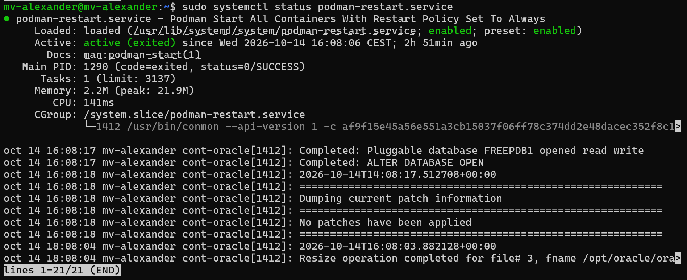

### Entrar en Oracle y crear el usuario de trabajo

Ahora entraremos en el contenedor de Podman y abriremos una terminal interactiva dentro de él. Para ello, ejecutamos:

```bash
sudo podman exec -it cont-oracle /bin/bash
```

- `podman exec`: Ejecuta un comando dentro de un contenedor que ya está funcionando.

- `-it`: Permite utilizar la terminal de forma interactiva.

- `cont-oracle`: Es el nombre del contenedor donde se ejecutará el comando.

- `/bin/bash`: Abre una terminal Bash dentro del contenedor.

> Si aparece algo parecido a `bash-4.4$`, significa que estamos dentro de la terminal del contenedor.

Para salir ejecutamos:

```bash
exit
```

Ahora volveremos a utilizar el contenedor, pero esta vez abriremos SQL*Plus para conectarnos a Oracle como administradores:

```bash
sudo podman exec -it cont-oracle sqlplus / as sysdba
```

- `sqlplus`: Abre la consola SQL*Plus de Oracle.

- `/`: Utiliza la autenticación interna del sistema sin introducir usuario y contraseña.

- `as sysdba`: Inicia la conexión con privilegios de administrador.

> Si aparece `SQL>` en la terminal, significa que hemos entrado correctamente.

Ahora comprobaremos las PDB existentes y verificaremos que `FREEPDB1` está disponible:

```sql
SHOW PDBS
```

Un ejemplo del resultado es:

| CON_ID | CON_NAME | OPEN MODE | RESTRICTED |
|---|---|---|---|
| 2 | PDB$SEED | READ ONLY | NO |
| 3 | FREEPDB1 | READ WRITE | NO |

Ahora cambiaremos la sesión actual para trabajar dentro de `FREEPDB1`, que es donde crearemos el usuario. Para ello, ejecutamos:

```sql
ALTER SESSION SET CONTAINER = FREEPDB1;
```

Ahora que estamos dentro de `FREEPDB1`, crearemos un usuario:

```sql
CREATE USER orauser IDENTIFIED BY "TU_CLAVE";
```

> Sustituye `TU_CLAVE` por una contraseña propia. La contraseña real no se debe subir al repositorio.

Ahora daremos permisos a `orauser` para iniciar sesión y crear tablas:

```sql
GRANT CREATE SESSION, CREATE TABLE TO orauser;
```

También permitiremos al usuario `orauser` utilizar hasta 100 MB de espacio en el tablespace `USERS`:

```sql
ALTER USER orauser QUOTA 100M ON USERS;
```

Para salir de SQL*Plus ejecutamos:

```sql
EXIT;
```

### Comprobar la conexión con orauser

Ahora comprobaremos la conexión con el usuario creado anteriormente:

```bash
sudo podman exec -it cont-oracle sqlplus orauser@//localhost:1521/FREEPDB1
```

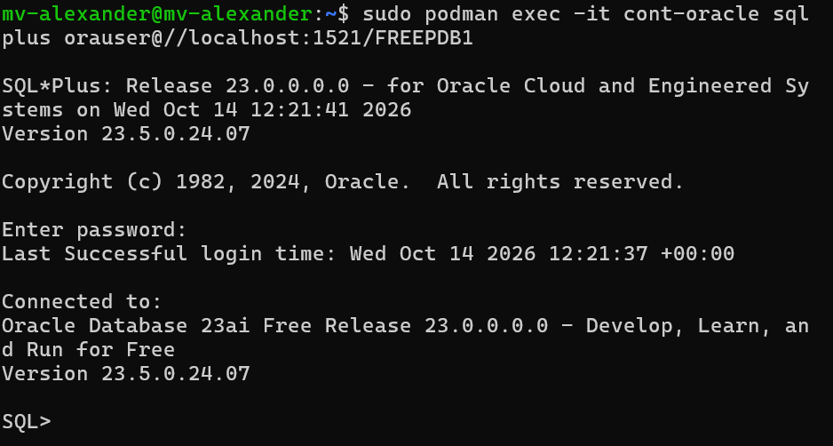

> Si nos pide la contraseña y podemos entrar correctamente, significa que el usuario `orauser` funciona.

---

## 4. Desplegar PostgreSQL

A diferencia de Oracle, para instalar PostgreSQL no es necesario utilizar un contenedor, ya que podemos instalarlo directamente mediante `apt`.

Primero actualizamos la lista de paquetes disponibles:

```bash
sudo apt update
```

Ahora instalaremos PostgreSQL junto con algunos paquetes adicionales:

```bash
sudo apt install postgresql postgresql-contrib php-pgsql
```

- `postgresql`: Instala el servidor de bases de datos PostgreSQL.

- `postgresql-contrib`: Instala herramientas y extensiones adicionales para PostgreSQL.

- `php-pgsql`: Instala el módulo que permite que PHP se conecte y trabaje con PostgreSQL.

Para verificar que se ha instalado correctamente ejecutamos:

```bash
psql --version
```

La versión instalada es:

```text
psql (PostgreSQL) 16.15
```

### Iniciar PostgreSQL

Para iniciar el servicio de PostgreSQL ejecutamos:

```bash
sudo systemctl start postgresql
```

Ahora configuraremos PostgreSQL para que se inicie automáticamente cada vez que arranque el equipo:

```bash
sudo systemctl enable postgresql
```

Para comprobar su estado ejecutamos:

```bash
sudo systemctl status postgresql
```

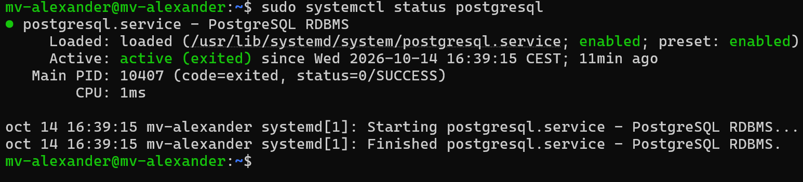

### Crear la Base de Datos y el usuario

Ahora cambiaremos de nuestro usuario de Linux Mint al usuario del sistema `postgres`, que fue creado automáticamente al instalar PostgreSQL:

```bash
sudo -i -u postgres
```

- `-i`: Inicia una sesión cargando el entorno del usuario indicado.

- `-u postgres`: Indica que queremos cambiar al usuario `postgres`.

Ahora entraremos a la consola interactiva de PostgreSQL:

```bash
psql
```

Dentro de la consola crearemos nuestra Base de Datos:

```sql
CREATE DATABASE dbpg;
```

Ahora crearemos un usuario para trabajar con la Base de Datos:

```sql
CREATE USER pguser WITH PASSWORD 'TU_CLAVE';
```

> Sustituye `TU_CLAVE` por una contraseña propia. La contraseña real no se debe subir al repositorio.

Ahora daremos al usuario permisos sobre la Base de Datos:

```sql
GRANT ALL PRIVILEGES ON DATABASE dbpg TO pguser;
```

Para salir de la consola de PostgreSQL ejecutamos:

```sql
\q
```

También tenemos que salir del usuario `postgres` y volver a nuestro usuario normal de Linux Mint:

```bash
exit
```

### Comprobar la conexión con pguser

Ahora probaremos la conexión con el usuario que creamos anteriormente:

```bash
psql -h localhost -U pguser -d dbpg -W
```

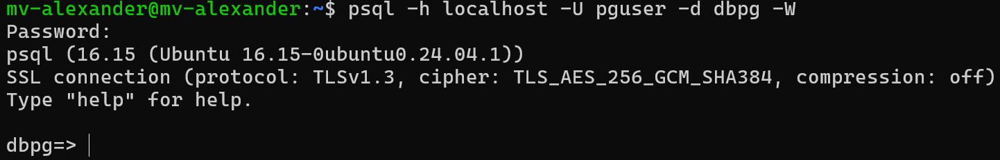

> Si nos pide la contraseña y podemos entrar correctamente a `dbpg`, significa que la conexión funciona.

---

## 5. Desplegar MariaDB

Al igual que PostgreSQL, MariaDB no necesita un contenedor y podemos instalarlo directamente mediante `apt`.

Primero actualizamos la lista de paquetes disponibles:

```bash
sudo apt update
```

Ahora instalaremos MariaDB:

```bash
sudo apt install mariadb-server mariadb-client
```

- `mariadb-server`: Instala el servidor de MariaDB, que es el programa que gestiona las bases de datos.

- `mariadb-client`: Instala las herramientas necesarias para conectarnos y trabajar con MariaDB desde la terminal.

Para comprobar la versión instalada ejecutamos:

```bash
mariadb --version
```

La versión instalada es:

```text
MariaDB 10.11.14
```

### Iniciar MariaDB

Para iniciar el servicio ejecutamos:

```bash
sudo systemctl start mariadb
```

Ahora configuraremos MariaDB para que se inicie automáticamente cada vez que arranque el equipo:

```bash
sudo systemctl enable --now mariadb
```

Para comprobar su estado ejecutamos:

```bash
sudo systemctl status mariadb
```

### Crear la Base de Datos y el usuario

Ahora entraremos en la consola de MariaDB:

```bash
sudo mariadb
```

Dentro de MariaDB crearemos nuestra Base de Datos:

```sql
CREATE DATABASE dbm CHARACTER SET utf8mb4 COLLATE utf8mb4_unicode_ci;
```

- `CREATE DATABASE dbm`: Crea una nueva Base de Datos llamada `dbm`.

- `CHARACTER SET utf8mb4`: Permite guardar caracteres Unicode, incluyendo acentos, símbolos y otros caracteres especiales.

- `COLLATE utf8mb4_unicode_ci`: Define cómo se comparan y ordenan los textos dentro de la Base de Datos.

Ahora crearemos un usuario para trabajar con la Base de Datos:

```sql
CREATE USER 'muser'@'localhost' IDENTIFIED BY 'TU_CLAVE';
```

- `'muser'@'localhost'`: Crea el usuario `muser` y permite que se conecte desde la propia máquina donde está instalado MariaDB.

- `IDENTIFIED BY 'TU_CLAVE'`: Establece la contraseña que utilizará el usuario.

> Sustituye `TU_CLAVE` por una contraseña propia. La contraseña real no se debe subir al repositorio.

Ahora daremos al usuario `muser` todos los permisos necesarios sobre la Base de Datos `dbm`:

```sql
GRANT ALL PRIVILEGES ON dbm.* TO 'muser'@'localhost';
```

Actualizamos los permisos:

```sql
FLUSH PRIVILEGES;
```

Y salimos de MariaDB:

```sql
EXIT;
```

### Comprobar la conexión con muser

Ahora comprobaremos que podemos conectarnos correctamente a la Base de Datos `dbm` con el usuario `muser`:

```bash
mariadb -u muser -p dbm
```

- `-u muser`: Indica el usuario con el que queremos conectarnos.

- `-p`: Hace que MariaDB nos pida la contraseña.

- `dbm`: Indica la Base de Datos a la que queremos entrar.

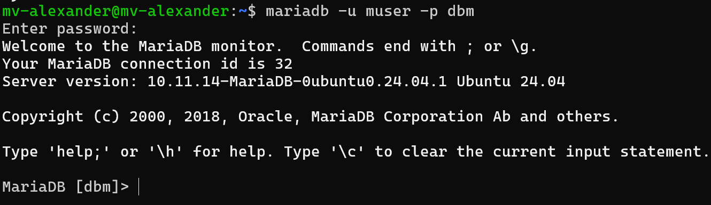

> Si nos pide la contraseña y podemos entrar correctamente a `dbm`, significa que la conexión funciona.

---

## 6. Resumen y comprobaciones

A continuación mostraremos un resumen de los datos principales de los tres SGBD que hemos instalado y configurado:

| SGBD | IP | Base/servicio | Puerto | Usuario | Contraseña |
|---|---|---|---|---|---|
| Oracle 23ai Free | 192.168.97.141 / localhost | FREEPDB1 | 1521 | orauser | La elegida por nosotros |
| PostgreSQL | 192.168.97.141 / localhost | dbpg | 5432 | pguser | La elegida por nosotros |
| MariaDB | 192.168.97.141 / localhost | dbm | 3306 | muser | La elegida por nosotros |

### Comprobar los puertos

Para comprobar si un puerto TCP es accesible podemos utilizar el comando `nc`:

```bash
nc -zv IP PUERTO
```

- `nc`: Utiliza la herramienta Netcat para comprobar conexiones de red.

- `-z`: Comprueba si el puerto está abierto sin enviar datos.

- `-v`: Muestra información sobre el resultado.

Para comprobar Oracle:

```bash
nc -zv localhost 1521
```

Para comprobar PostgreSQL:

```bash
nc -zv localhost 5432
```

Para comprobar MariaDB:

```bash
nc -zv localhost 3306
```

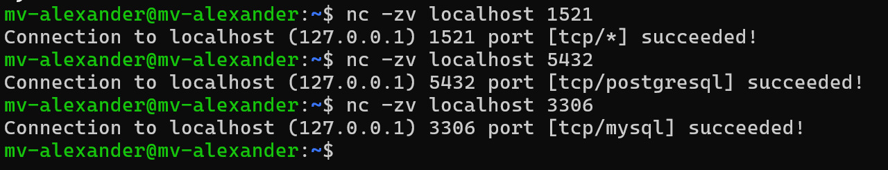

> Si los puertos responden correctamente significa que los servicios son accesibles a través de esos puertos.

> Que un puerto responda no significa que el usuario pueda iniciar sesión, por eso también hemos realizado las conexiones con `orauser`, `pguser` y `muser`.

---

## 7. Conexiones desde otra máquina

Ahora configuraremos PostgreSQL y MariaDB para permitir conexiones desde otro equipo de la red.

En esta práctica utilizaremos:

```text
Servidor: 192.168.97.141
Cliente:  192.168.97.131
```

### PostgreSQL

Primero tenemos que localizar el archivo de configuración `postgresql.conf`.

Normalmente se encuentra en:

```bash
/etc/postgresql/XX/main/postgresql.conf
```

> Sustituye `XX` por la versión de PostgreSQL instalada.

En nuestro caso utilizamos PostgreSQL 16, por lo que la ruta será:

```bash
/etc/postgresql/16/main/postgresql.conf
```

Dentro del archivo buscaremos la opción `listen_addresses` y pondremos la dirección IP de nuestra máquina virtual:

```text
listen_addresses = '192.168.97.141'
```

- `listen_addresses`: Indica en qué dirección IP escuchará PostgreSQL las conexiones.

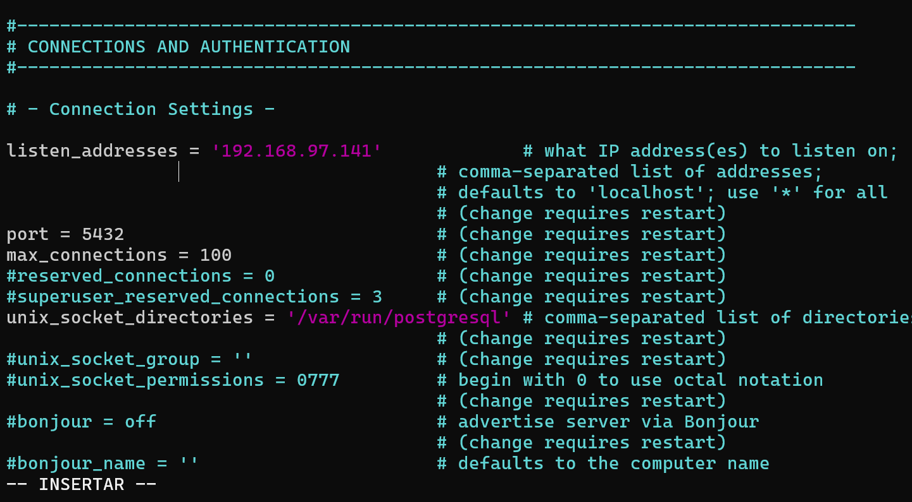

Ahora localizaremos el archivo `pg_hba.conf`, que se encuentra en el mismo directorio:

```bash
/etc/postgresql/16/main/pg_hba.conf
```

Dentro añadiremos una regla para permitir la conexión a la Base de Datos `dbpg` con el usuario `pguser` desde nuestra máquina cliente:

```text
host dbpg pguser 192.168.97.131/32 scram-sha-256
```

- `host`: Indica que se permitirá una conexión mediante red.

- `dbpg`: Es la Base de Datos a la que permitiremos la conexión.

- `pguser`: Es el usuario que podrá conectarse.

- `192.168.97.131/32`: Permite únicamente la dirección IP de nuestra máquina cliente.

- `scram-sha-256`: Es el método de autenticación utilizado para comprobar la contraseña.

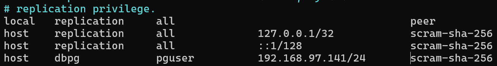

Después de guardar los cambios reiniciaremos PostgreSQL:

```bash
sudo systemctl restart postgresql
```

Si el cortafuegos `UFW` está activo, permitiremos las conexiones al puerto `5432` solamente desde la máquina cliente:

```bash
sudo ufw allow from 192.168.97.131 to any port 5432 proto tcp
```

- `192.168.97.131`: Es la dirección IP del cliente autorizado.

- `5432`: Es el puerto utilizado por PostgreSQL.

- `proto tcp`: Indica que la regla se aplicará a conexiones TCP.

#### Preparar la máquina cliente

Antes de realizar la conexión desde la máquina cliente tenemos que instalar el cliente de PostgreSQL:

```bash
sudo apt update
sudo apt install postgresql-client
```

Para comprobar que se ha instalado correctamente:

```bash
psql --version
```

Ahora probaremos la conexión desde la máquina cliente:

```bash
psql -h 192.168.97.141 -U pguser -d dbpg -W
```

- `-h 192.168.97.141`: Indica la dirección IP de la máquina donde está instalado PostgreSQL.

- `-U pguser`: Indica el usuario con el que queremos conectarnos.

- `-d dbpg`: Indica la Base de Datos a la que queremos entrar.

- `-W`: Hace que PostgreSQL nos pida la contraseña.

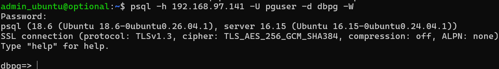

> Si nos pide la contraseña y podemos entrar correctamente a la Base de Datos, la conexión remota funciona.

---

### MariaDB

Ahora configuraremos MariaDB para permitir conexiones desde nuestra máquina cliente.

El archivo de configuración normalmente se encuentra en:

```bash
/etc/mysql/mariadb.conf.d/50-server.cnf
```

Dentro del archivo buscaremos la sección `[mysqld]` y cambiaremos la opción `bind-address` para que MariaDB escuche en la dirección IP de nuestra máquina virtual:

```text
bind-address = 192.168.97.141
```

- `bind-address`: Indica en qué dirección IP escuchará MariaDB las conexiones.

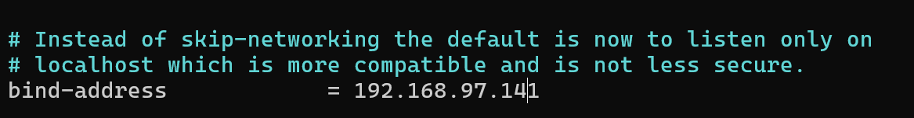

Ahora entraremos de nuevo en la consola de MariaDB:

```bash
sudo mariadb
```

Crearemos un usuario que pueda conectarse solamente desde nuestra máquina cliente:

```sql
CREATE USER 'muser'@'192.168.97.131' IDENTIFIED BY 'TU_CLAVE';
```

Ahora le daremos permisos sobre la Base de Datos `dbm`:

```sql
GRANT ALL PRIVILEGES ON dbm.* TO 'muser'@'192.168.97.131';
```

Actualizamos los permisos:

```sql
FLUSH PRIVILEGES;
```

Y salimos de MariaDB:

```sql
EXIT;
```

Ahora reiniciaremos el servicio para aplicar los cambios:

```bash
sudo systemctl restart mariadb
```

Si el cortafuegos `UFW` está activo, permitiremos las conexiones al puerto `3306` solamente desde nuestra máquina cliente:

```bash
sudo ufw allow from 192.168.97.131 to any port 3306 proto tcp
```

- `192.168.97.131`: Es la dirección IP del cliente autorizado.

- `3306`: Es el puerto utilizado por MariaDB.

- `proto tcp`: Indica que la regla se aplicará a conexiones TCP.

#### Preparar la máquina cliente

Antes de probar la conexión tenemos que instalar el cliente de MariaDB:

```bash
sudo apt update
sudo apt install mariadb-client
```

Para comprobar que se ha instalado correctamente:

```bash
mariadb --version
```

Ahora probaremos la conexión desde la máquina cliente:

```bash
mariadb -h 192.168.97.141 -u muser -p dbm
```

- `-h 192.168.97.141`: Indica la dirección IP de la máquina donde está instalado MariaDB.

- `-u muser`: Indica el usuario con el que queremos conectarnos.

- `-p`: Hace que MariaDB nos pida la contraseña.

- `dbm`: Indica la Base de Datos a la que queremos entrar.

En nuestro caso apareció un error relacionado con SSL/TLS. Este problema se explica con más detalle en el apartado de problemas encontrados.

Para realizar la conexión utilizamos:

```bash
mariadb --skip-ssl -h 192.168.97.141 -u muser -p dbm
```

- `--skip-ssl`: Desactiva el uso de SSL/TLS para esta conexión.

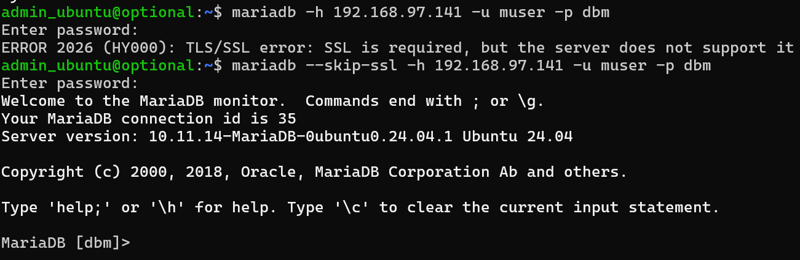

> Después de utilizar este comando pudimos entrar correctamente en `dbm` desde la máquina cliente.

---

## 8. Problemas encontrados

Durante la práctica encontramos algunos problemas que tuvimos que solucionar.

### Error al descargar la imagen de Oracle

Al intentar crear el contenedor escribimos incorrectamente la dirección del registro de Oracle:

```text
containerregistry.oracle.com
```

El nombre correcto era:

```text
container-registry.oracle.com
```

Después de corregirlo pudimos descargar y utilizar la imagen correctamente.

### Cliente de PostgreSQL no instalado

Al intentar realizar la conexión desde la máquina cliente instalamos primero:

```bash
sudo apt install postgresql-client-common
```

Pero al intentar utilizar `psql` apareció el siguiente mensaje:

```text
Error: You must install at least one postgresql-client-<version> package
```

Para solucionarlo instalamos el cliente completo de PostgreSQL:

```bash
sudo apt install postgresql-client
```

Después de instalarlo pudimos utilizar `psql` y realizar la conexión remota correctamente.

### Error al utilizar una IP incorrecta en MariaDB

Al realizar una de las primeras pruebas de conexión utilizamos una dirección IP incorrecta:

```text
192.168.71.141
```

La dirección IP correcta del servidor era:

```text
192.168.97.141
```

Después de utilizar la IP correcta pudimos continuar con la conexión.

### Error de SSL/TLS en MariaDB

Al intentar conectarnos desde la máquina cliente apareció el siguiente error:

```text
ERROR 2026 (HY000): TLS/SSL error: SSL is required, but the server does not support it
```

El problema ocurría porque el cliente intentaba utilizar SSL/TLS pero el servidor MariaDB no lo tenía configurado.

Para esta práctica solucionamos el problema desactivando SSL/TLS en esa conexión:

```bash
mariadb --skip-ssl -h 192.168.97.141 -u muser -p dbm
```

Después de utilizar este comando pudimos conectarnos correctamente desde la máquina cliente.

---

## 9. Bibliografía y recursos consultados

| Recurso | Uso | Fecha |
|---|---|---|
| Material proporcionado por el profesor: Práctica "Instalar tres SGBD" | Utilizado como guía principal para realizar la instalación, configuración y comprobaciones de Oracle Database 23ai Free, PostgreSQL y MariaDB. | 13/10/2026 |
| ChatGPT (OpenAI) | Utilizado para aclarar algunos comandos, revisar la estructura del README y entender el error de SSL/TLS que apareció durante la conexión remota a MariaDB. | 14/10/2026 |

--- 
