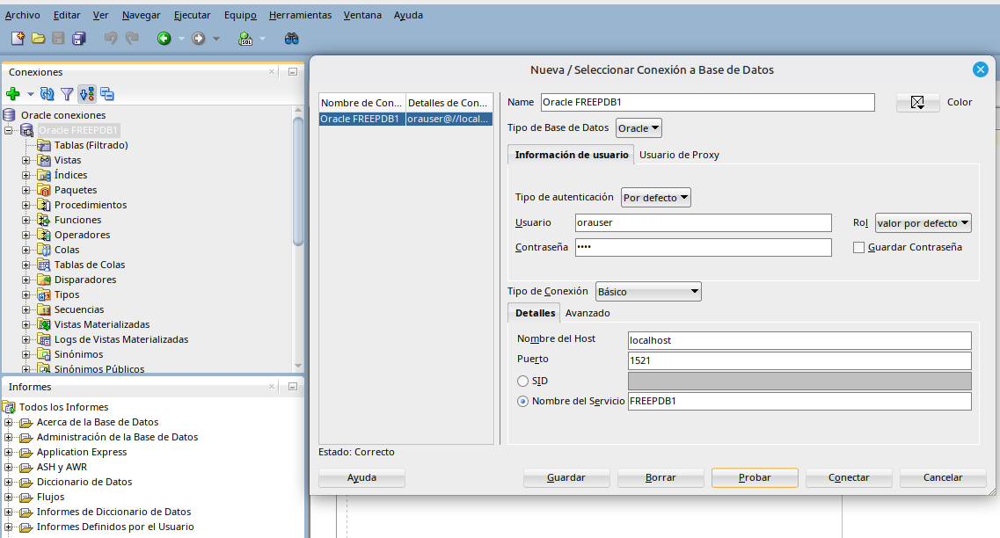
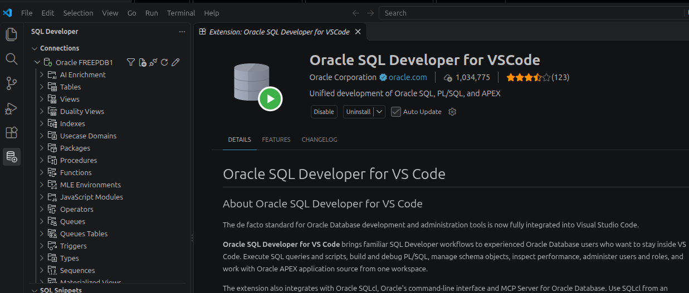
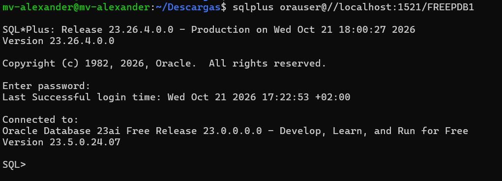
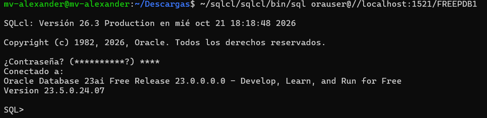
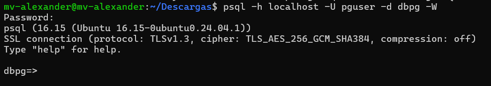
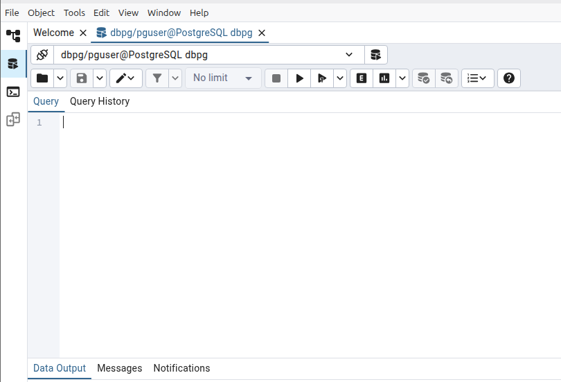
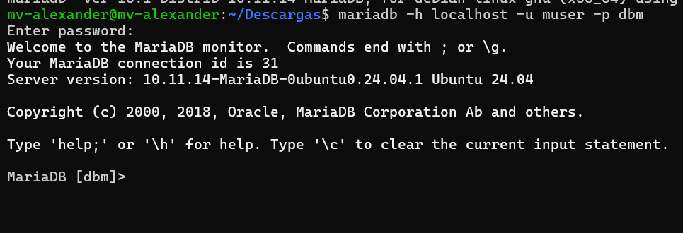
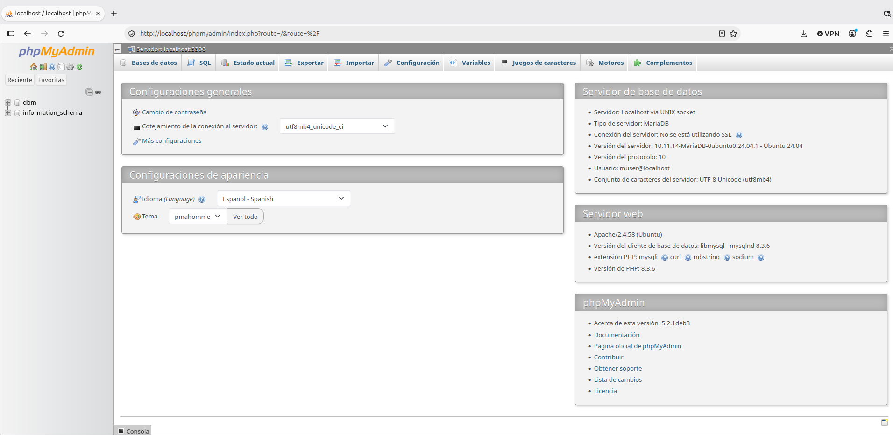
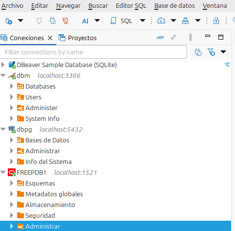
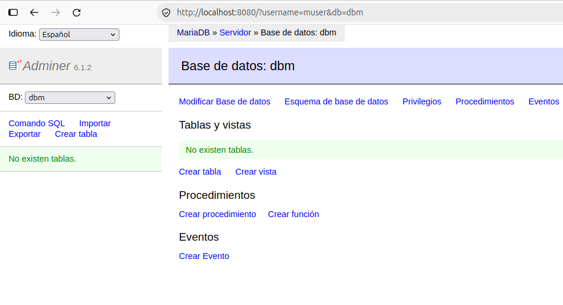

# Práctica: Instalación de clientes para Oracle, PostgreSQL y MariaDB

## Datos de la práctica

- **Nombre y Apellidos:** Alexander Manuel Huaman Linares
- **Grupo:** ASIR 2
- **Título de la tarea:** Instalación de clientes para tres SGBD
- **Fecha:** 21/10/2026

---

## Índice

1. [Objetivo](#1-objetivo)
2. [Datos de la máquina y servidores](#2-datos-de-la-máquina-y-servidores)
3. [Clientes para Oracle Database](#3-clientes-para-oracle-database)
4. [Clientes para PostgreSQL](#4-clientes-para-postgresql)
5. [Clientes para MariaDB](#5-clientes-para-mariadb)
6. [Clientes para varios SGBD](#6-clientes-para-varios-sgbd)
7. [Resumen de conexiones](#7-resumen-de-conexiones)
8. [Problemas encontrados](#8-problemas-encontrados)
9. [Bibliografía y recursos consultados](#9-bibliografía-y-recursos-consultados)

---

## 1. Objetivo

El objetivo de esta práctica es instalar y probar distintos clientes de consola, gráficos y web para conectarnos a Oracle Database 23ai Free, PostgreSQL y MariaDB, que ya fueron instalados en la práctica anterior.

---

## 2. Datos de la máquina y servidores

### Máquina virtual

- **Sistema operativo:** Linux Mint
- **RAM:** 4 GB
- **CPU:** 2 vCPU
- **Almacenamiento:** 250 GB
- **IP de la máquina virtual:** 192.168.97.141

### Datos de los SGBD

| SGBD | Servidor | Base/servicio | Puerto | Usuario |
|---|---|---|---|---|
| Oracle Database 23ai Free | localhost | FREEPDB1 | 1521 | orauser |
| PostgreSQL | localhost | dbpg | 5432 | pguser |
| MariaDB | localhost | dbm | 3306 | muser |

> Las contraseñas utilizadas durante la práctica no se incluyen en el repositorio.

---

## 3. Clientes para Oracle Database

### 3.1. SQL Developer

#### Dependencias necesarias

Antes de iniciar SQL Developer instalamos Java y `unzip`:

```bash
sudo apt update
sudo apt install default-jdk unzip
java --version
```

#### Instalación

Descargamos SQL Developer desde:

```text
https://www.oracle.com/database/sqldeveloper/technologies/download/
```

El archivo descargado fue:

```text
sqldeveloper-26.2.0.186.2220-x64.zip
```

Lo descomprimimos en `/opt`:

```bash
sudo unzip sqldeveloper-26.2.0.186.2220-x64.zip -d /opt/
```

Para iniciar SQL Developer ejecutamos:

```bash
/opt/sqldeveloper/sqldeveloper.sh
```

Al intentar abrirlo apareció el siguiente error:

```text
java.lang.module.FindException: Module javafx.base not found
```

El JDK que estaba utilizando no incluía JavaFX, por lo que instalamos BellSoft JDK 17 Full.

Primero descargamos el paquete:

```bash
wget https://download.bell-sw.com/java/17.0.10+13/bellsoft-jdk17.0.10+13-linux-amd64-full.deb -O ~/Descargas/jdk17-full.deb
```

Después lo instalamos:

```bash
sudo apt install ~/Descargas/jdk17-full.deb -y
```

Comprobamos la versión:

```bash
/usr/lib/jvm/bellsoft-java17-full-amd64/bin/java --version
```

El resultado fue:

```text
openjdk 17.0.10 2024-01-16 LTS
OpenJDK Runtime Environment (build 17.0.10+13-LTS)
OpenJDK 64-Bit Server VM (build 17.0.10+13-LTS, mixed mode, sharing)
```

Volvimos a iniciar SQL Developer:

```bash
/opt/sqldeveloper/sqldeveloper.sh
```

Esta vez se abrió correctamente.

#### Versión instalada

La versión instalada de SQL Developer es:

```text
26.2.0.186.2220
```

#### Configurar la conexión

Creamos una conexión con los siguientes datos:

- **Servidor:** localhost
- **Puerto:** 1521
- **Servicio:** FREEPDB1
- **Usuario:** orauser

Como SQL Developer está instalado en la misma máquina virtual donde funciona Oracle, utilizamos `localhost`.

Después probamos la conexión y comprobamos que funcionaba correctamente.



> Esta imagen demuestra que SQL Developer se ha conectado correctamente a Oracle Database con el usuario `orauser`.

---

### 3.2. VS Code + Oracle SQL Developer

#### Instalación

Descargamos Visual Studio Code desde:

```text
https://code.visualstudio.com/
```

Fuimos a la carpeta de descargas:

```bash
cd ~/Descargas
```

E instalamos el archivo descargado:

```bash
sudo apt install ./code_1.143.0-1792533444_amd64.deb
```

#### Instalar la extensión

Abrimos VS Code y desde el apartado de extensiones buscamos:

```text
Oracle SQL Developer
```

Instalamos la extensión publicada por Oracle.

#### Versión instalada

La versión instalada de VS Code es:

```text
1.143.0
```

La versión de la extensión Oracle SQL Developer para VS Code es:

```text
26.3.0
```

#### Configurar la conexión

Configuramos la conexión con:

- **Servidor:** localhost
- **Puerto:** 1521
- **Servicio:** FREEPDB1
- **Usuario:** orauser

Probamos la conexión y pudimos acceder correctamente a los objetos de la base de datos.



> Esta imagen demuestra que podemos conectarnos a Oracle desde VS Code utilizando la extensión Oracle SQL Developer.

---

### 3.3. SQL*Plus

#### Instalación

Para utilizar SQL*Plus descargamos desde Oracle Instant Client los paquetes `Basic` y `SQL*Plus` de la misma versión:

```text
https://www.oracle.com/database/technologies/instant-client/downloads.html
```

Los archivos descargados fueron:

```text
instantclient-basic-linux.x64-23.26.4.0.0.zip
instantclient-sqlplus-linux.x64-23.26.4.0.0.zip
```

Creamos una carpeta para guardar el cliente:

```bash
mkdir -p ~/oracle-client
```

Descomprimimos los dos archivos en la misma carpeta:

```bash
unzip instantclient-basic-linux.x64-23.26.4.0.0.zip -d ~/oracle-client
unzip instantclient-sqlplus-linux.x64-23.26.4.0.0.zip -d ~/oracle-client
```

Al descomprimir el segundo archivo aparecieron algunos archivos repetidos. Elegimos la opción `A` para reemplazarlos todos y continuar.

Comprobamos el contenido:

```bash
ls ~/oracle-client
```

El resultado fue:

```text
instantclient_23_26  META-INF
```

#### Configurar las rutas

Como el directorio creado fue `instantclient_23_26`, configuramos las rutas:

```bash
export LD_LIBRARY_PATH="$HOME/oracle-client/instantclient_23_26:$LD_LIBRARY_PATH"
export PATH="$HOME/oracle-client/instantclient_23_26:$PATH"
```

Después intentamos comprobar la versión:

```bash
sqlplus -v
```

Pero apareció:

```text
sqlplus: error while loading shared libraries: libaio.so.1: cannot open shared object file: No such file or directory
```

Comprobamos que `libaio1t64` ya estaba instalado:

```bash
sudo apt install libaio1t64
```

Como SQL*Plus seguía buscando `libaio.so.1`, creamos un enlace simbólico:

```bash
sudo ln -s /usr/lib/x86_64-linux-gnu/libaio.so.1t64 /usr/lib/x86_64-linux-gnu/libaio.so.1
```

Después actualizamos la caché de librerías:

```bash
sudo ldconfig
```

Tras esto SQL*Plus pudo ejecutarse correctamente.

#### Versión instalada

Comprobamos la versión:

```bash
sqlplus -v
```

El resultado fue:

```text
SQL*Plus: Release 23.26.4.0.0 - Production
Version 23.26.4.0.0
```

La versión instalada es:

```text
23.26.4.0.0
```

#### Probar la conexión

Nos conectamos a Oracle con:

```bash
sqlplus orauser@//localhost:1521/FREEPDB1
```

La contraseña se introduce cuando SQL*Plus la solicita y no se escribe directamente en el comando.



> Esta imagen demuestra que SQL*Plus puede conectarse correctamente a `FREEPDB1` con el usuario `orauser`.

---

### 3.4. SQLcl

#### Dependencias necesarias

SQLcl necesita Java y `unzip`:

```bash
sudo apt install default-jdk unzip
java --version
```

#### Instalación

Descargamos SQLcl desde:

```text
https://www.oracle.com/database/sqldeveloper/technologies/sqlcl/download/
```

Fuimos a la carpeta de descargas:

```bash
cd ~/Descargas
```

Descomprimimos el archivo:

```bash
unzip sqlcl-latest.zip -d ~/sqlcl
```

#### Versión instalada

Comprobamos la versión:

```bash
~/sqlcl/sqlcl/bin/sql -version
```

La versión instalada es:

```text
26.3.0.0
```

La versión interna es:

```text
26.3.0.260.1620
```

#### Configurar PATH opcionalmente

Si queremos ejecutar `sql` desde cualquier terminal podemos añadir a `~/.bashrc`:

```bash
export PATH="$HOME/sqlcl/sqlcl/bin:$PATH"
```

#### Probar la conexión

Nos conectamos a Oracle con:

```bash
~/sqlcl/sqlcl/bin/sql orauser@//localhost:1521/FREEPDB1
```

SQLcl solicita la contraseña del usuario `orauser`.

La conexión se realizó correctamente y pudimos acceder al servicio `FREEPDB1`.



> Esta imagen demuestra que SQLcl se ha conectado correctamente a Oracle Database con el usuario `orauser`.

---

## 4. Clientes para PostgreSQL

### 4.1. psql

#### Instalación

Instalamos el cliente de PostgreSQL:

```bash
sudo apt update
sudo apt install postgresql-client
```

#### Versión instalada

Comprobamos la versión:

```bash
psql --version
```

La versión instalada es:

```text
16.15
```

#### Probar la conexión

Intentamos conectarnos con:

```bash
psql -h localhost -U pguser -d dbpg -W
```

La primera vez apareció:

```text
psql: error: connection to server at "localhost" (127.0.0.1), port 5432 failed: Conexión rehusada
Is the server running on that host and accepting TCP/IP connections?
```

PostgreSQL estaba configurado para escuchar solamente en la IP de la máquina virtual:

```text
192.168.97.141
```

Abrimos su configuración:

```bash
sudo nano /etc/postgresql/16/main/postgresql.conf
```

Cambiamos:

```text
listen_addresses = '192.168.97.141'
```

por:

```text
listen_addresses = 'localhost,192.168.97.141'
```

Después editamos:

```bash
sudo nano /etc/postgresql/16/main/pg_hba.conf
```

Añadimos:

```text
host    dbpg    pguser    127.0.0.1/32    scram-sha-256
```

Reiniciamos PostgreSQL:

```bash
sudo systemctl restart postgresql
```

Después volvimos a ejecutar:

```bash
psql -h localhost -U pguser -d dbpg -W
```

Los datos utilizados fueron:

- **Servidor:** localhost
- **Puerto:** 5432
- **Base de Datos:** dbpg
- **Usuario:** pguser

La opción `-W` hace que `psql` solicite la contraseña.



> Esta imagen demuestra que `psql` puede conectarse correctamente a `dbpg` con el usuario `pguser`.

---

### 4.2. pgAdmin 4

#### Dependencias necesarias

Instalamos las dependencias:

```bash
sudo apt install curl gnupg lsb-release
```

Añadimos la clave del repositorio oficial de pgAdmin:

```bash
curl -fsS https://www.pgadmin.org/static/packages_pgadmin_org.pub | sudo gpg --dearmor -o /etc/apt/keyrings/packages-pgadmin-org.gpg
```

#### Instalación

Primero comprobamos el nombre en clave de Linux Mint:

```bash
lsb_release -cs
```

El resultado fue:

```text
zena
```

Al intentar instalar pgAdmin directamente:

```bash
sudo apt install pgadmin4-desktop
```

apareció:

```text
E: No se ha podido localizar el paquete pgadmin4-desktop
```

El repositorio no reconocía directamente el nombre en clave `zena`, por lo que configuramos el repositorio de Ubuntu 24.04 `noble`:

```bash
sudo sh -c 'echo "deb [signed-by=/etc/apt/keyrings/packages-pgadmin-org.gpg] https://ftp.postgresql.org/pub/pgadmin/pgadmin4/apt/noble pgadmin4 main" > /etc/apt/sources.list.d/pgadmin4.list && apt update'
```

Actualizamos los repositorios:

```bash
sudo apt update
```

E instalamos pgAdmin 4 Desktop:

```bash
sudo apt install pgadmin4-desktop
```

La instalación terminó correctamente y la aplicación quedó disponible desde el menú de Linux Mint.

#### Versión instalada

Comprobamos la versión con:

```bash
dpkg -l | grep pgadmin4-desktop
```

El resultado fue:

```text
ii  pgadmin4-desktop  9.18  amd64  The desktop user interface for pgAdmin.
```

La versión instalada de pgAdmin 4 es:

```text
9.18
```

#### Configurar la conexión

Creamos una conexión con:

- **Servidor:** localhost
- **Puerto:** 5432
- **Base de Datos:** dbpg
- **Usuario:** pguser

En la pantalla de conexión utilizamos:

```text
Server Name: PostgreSQL dbpg
Host name/address: localhost
Port: 5432
Database: dbpg
User: pguser
SSL mode: prefer
```

Después pulsamos `Connect & Open Query Tool`.

La conexión se realizó correctamente y se abrió el Query Tool conectado a:

```text
dbpg/pguser@PostgreSQL dbpg
```



> Esta imagen demuestra que pgAdmin 4 se ha conectado correctamente a la base de datos `dbpg` con el usuario `pguser`.

---

## 5. Clientes para MariaDB

### 5.1. Cliente mariadb

#### Instalación

Instalamos el cliente de MariaDB:

```bash
sudo apt update
sudo apt install mariadb-client
```

#### Versión instalada

Comprobamos la versión:

```bash
mariadb --version
```

El resultado fue:

```text
mariadb  Ver 15.1 Distrib 10.11.14-MariaDB, for debian-linux-gnu (x86_64) using EditLine wrapper
```

La versión instalada es:

```text
10.11.14-MariaDB
```

#### Probar la conexión

Ejecutamos:

```bash
mariadb -h localhost -u muser -p dbm
```

Los datos utilizados fueron:

- **Servidor:** localhost
- **Puerto:** 3306
- **Base de Datos:** dbm
- **Usuario:** muser

La opción `-p` hace que MariaDB solicite la contraseña.

La conexión se realizó correctamente y apareció:

```text
MariaDB [dbm]>
```



> Esta imagen demuestra que el cliente de MariaDB puede conectarse correctamente a `dbm` con el usuario `muser`.

---

### 5.2. phpMyAdmin

#### Instalación

Instalamos Apache, PHP y phpMyAdmin:

```bash
sudo apt update
sudo apt install apache2 php php-mysql php-mbstring php-zip php-gd php-curl phpmyadmin
sudo phpenmod mbstring
sudo systemctl restart apache2
```

Durante la instalación seleccionamos `apache2` como servidor web.

También permitimos que `dbconfig-common` realizara la configuración de la base de datos interna de phpMyAdmin.

Después intentamos acceder a:

```text
http://localhost/phpmyadmin/
```

Pero apareció:

```text
404 Not Found
The requested URL was not found on this server.
```

Apache estaba funcionando, pero la configuración de phpMyAdmin no estaba habilitada.

Intentamos:

```bash
sudo a2enconf phpmyadmin
```

pero apareció:

```text
ERROR: Conf phpmyadmin does not exist!
```

La configuración de phpMyAdmin se encontraba en:

```text
/etc/phpmyadmin/apache.conf
```

Creamos un enlace simbólico:

```bash
sudo ln -s /etc/phpmyadmin/apache.conf /etc/apache2/conf-available/phpmyadmin.conf
```

Después habilitamos la configuración:

```bash
sudo a2enconf phpmyadmin
```

Y recargamos Apache:

```bash
sudo systemctl reload apache2
```

Tras estos pasos phpMyAdmin quedó accesible correctamente.

#### Versión instalada

La versión instalada de phpMyAdmin es:

```text
5.2.1deb3
```

#### Probar la conexión

Abrimos:

```text
http://localhost/phpmyadmin/
```

Iniciamos sesión utilizando:

- **Servidor:** localhost
- **Puerto:** 3306
- **Base de Datos:** dbm
- **Usuario:** muser

La conexión se realizó correctamente y pudimos acceder a `dbm`.



> Esta imagen demuestra que phpMyAdmin se ha conectado correctamente a MariaDB con el usuario `muser` y que podemos acceder a la base de datos `dbm`.

---

## 6. Clientes para varios SGBD

### 6.1. DBeaver Community

#### Instalación

Descargamos DBeaver Community desde:

```text
https://dbeaver.io/download/
```

El archivo descargado fue:

```text
dbeaver-ce-26.2.3-linux-x86_64.deb
```

Fuimos a la carpeta de descargas:

```bash
cd ~/Descargas
```

E instalamos el paquete:

```bash
sudo apt install ./dbeaver-ce-26.2.3-linux-x86_64.deb
```

#### Versión instalada

La versión instalada de DBeaver Community es:

```text
26.2.3
```

#### Configurar las conexiones

Configuramos una conexión para cada SGBD:

| SGBD | Servidor | Base/servicio | Puerto | Usuario |
|---|---|---|---|---|
| Oracle | localhost | FREEPDB1 | 1521 | orauser |
| PostgreSQL | localhost | dbpg | 5432 | pguser |
| MariaDB | localhost | dbm | 3306 | muser |

DBeaver descargó los controladores JDBC necesarios para realizar las conexiones.

#### Conexión a Oracle

Utilizamos:

- **Host:** localhost
- **Puerto:** 1521
- **Tipo:** Service Name
- **Servicio:** FREEPDB1
- **Usuario:** orauser

Probamos la conexión y funcionó correctamente.

#### Conexión a PostgreSQL

Utilizamos:

- **Host:** localhost
- **Puerto:** 5432
- **Base de Datos:** dbpg
- **Usuario:** pguser

Probamos la conexión y funcionó correctamente.

#### Conexión a MariaDB

Utilizamos:

- **Host:** localhost
- **Puerto:** 3306
- **Base de Datos:** dbm
- **Usuario:** muser

Al probar inicialmente la conexión apareció:

```text
Socket fail to connect to localhost. Conexión rehusada (connect failed)
```

MariaDB estaba configurado para escuchar solamente en la IP de la máquina virtual.

Abrimos:

```bash
sudo nano /etc/mysql/mariadb.conf.d/50-server.cnf
```

Cambiamos:

```text
bind-address = 192.168.97.141
```

por:

```text
bind-address = 0.0.0.0
```

Reiniciamos MariaDB:

```bash
sudo systemctl restart mariadb
```

Y comprobamos su estado:

```bash
sudo systemctl status mariadb
```

Después volvimos a probar la conexión desde DBeaver.



> Esta imagen demuestra que DBeaver Community puede conectarse a Oracle, PostgreSQL y MariaDB.

---

### 6.2. Adminer

#### Instalación

Instalamos PHP CLI:

```bash
sudo apt install php-cli
```

Descargamos Adminer:

```bash
wget https://www.adminer.org/latest.php -O adminer.php
```

El archivo se guardó como:

```text
adminer.php
```

Iniciamos el servidor local:

```bash
php -S 127.0.0.1:8080 adminer.php
```

Al principio intentamos abrir Adminer sin tener el servidor ejecutándose y el navegador no podía conectarse a:

```text
localhost:8080
```

Volvimos a ejecutar:

```bash
php -S 127.0.0.1:8080 adminer.php
```

y dejamos la terminal abierta mientras utilizábamos Adminer.

#### Probar la conexión

Abrimos:

```text
http://localhost:8080/
```

Probamos la conexión con MariaDB utilizando:

- **Motor de base de datos:** MySQL / MariaDB
- **Servidor:** localhost
- **Usuario:** muser
- **Base de Datos:** dbm

La contraseña se introdujo directamente en Adminer y no se incluyó en el README.

La conexión se realizó correctamente y pudimos acceder a `dbm`.



> Esta imagen demuestra que Adminer se ha conectado correctamente a MariaDB con el usuario `muser`.

Para detener el servidor utilizamos:

```text
Ctrl+C
```

---

## 7. Resumen de conexiones

| SGBD | Cliente de consola | Cliente gráfico o web |
|---|---|---|
| Oracle Database 23ai Free | SQL*Plus / SQLcl | SQL Developer / VS Code |
| PostgreSQL | psql | pgAdmin 4 |
| MariaDB | mariadb | phpMyAdmin |

También utilizamos DBeaver Community para conectarnos a los tres SGBD.

Además utilizamos Adminer como cliente web para MariaDB.

### Datos utilizados

| SGBD | Servidor | Base/servicio | Puerto | Usuario |
|---|---|---|---|---|
| Oracle Database 23ai Free | localhost | FREEPDB1 | 1521 | orauser |
| PostgreSQL | localhost | dbpg | 5432 | pguser |
| MariaDB | localhost | dbm | 3306 | muser |

> Ninguna contraseña utilizada durante la práctica se incluye en el repositorio.

---

## 8. Problemas encontrados

Durante la práctica aparecieron varios problemas durante la instalación y configuración de algunos clientes.

### Problema 1: SQL Developer no encontraba JavaFX

**Error:**

```text
java.lang.module.FindException: Module javafx.base not found
```

**Solución:**

El JDK que estaba utilizando SQL Developer no incluía JavaFX.

Instalamos BellSoft JDK 17 Full:

```bash
wget https://download.bell-sw.com/java/17.0.10+13/bellsoft-jdk17.0.10+13-linux-amd64-full.deb -O ~/Descargas/jdk17-full.deb
sudo apt install ~/Descargas/jdk17-full.deb -y
```

Comprobamos la instalación:

```bash
/usr/lib/jvm/bellsoft-java17-full-amd64/bin/java --version
```

Después volvimos a iniciar SQL Developer:

```bash
/opt/sqldeveloper/sqldeveloper.sh
```

Esta vez se abrió correctamente.

---

### Problema 2: SQL*Plus no encontraba libaio

**Error:**

```text
sqlplus: error while loading shared libraries: libaio.so.1: cannot open shared object file: No such file or directory
```

**Solución:**

Comprobamos que `libaio1t64` estaba instalado:

```bash
sudo apt install libaio1t64
```

SQL*Plus seguía buscando `libaio.so.1`, por lo que creamos un enlace simbólico:

```bash
sudo ln -s /usr/lib/x86_64-linux-gnu/libaio.so.1t64 /usr/lib/x86_64-linux-gnu/libaio.so.1
```

Actualizamos la caché:

```bash
sudo ldconfig
```

Después SQL*Plus funcionó correctamente.

---

### Problema 3: PostgreSQL rechazaba la conexión mediante localhost

**Error:**

```text
psql: error: connection to server at "localhost" (127.0.0.1), port 5432 failed: Conexión rehusada
Is the server running on that host and accepting TCP/IP connections?
```

**Solución:**

PostgreSQL estaba escuchando únicamente en:

```text
192.168.97.141
```

Editamos:

```bash
sudo nano /etc/postgresql/16/main/postgresql.conf
```

Cambiamos:

```text
listen_addresses = '192.168.97.141'
```

por:

```text
listen_addresses = 'localhost,192.168.97.141'
```

Después editamos:

```bash
sudo nano /etc/postgresql/16/main/pg_hba.conf
```

Añadimos:

```text
host    dbpg    pguser    127.0.0.1/32    scram-sha-256
```

Y reiniciamos PostgreSQL:

```bash
sudo systemctl restart postgresql
```

Después la conexión mediante `localhost` funcionó correctamente.

---

### Problema 4: No se encontraba el paquete pgAdmin 4

**Error:**

```text
E: No se ha podido localizar el paquete pgadmin4-desktop
```

**Solución:**

Comprobamos el nombre en clave:

```bash
lsb_release -cs
```

El resultado fue:

```text
zena
```

Como el repositorio de pgAdmin no reconocía directamente este nombre de Linux Mint, utilizamos el repositorio de Ubuntu 24.04 `noble`:

```bash
sudo sh -c 'echo "deb [signed-by=/etc/apt/keyrings/packages-pgadmin-org.gpg] https://ftp.postgresql.org/pub/pgadmin/pgadmin4/apt/noble pgadmin4 main" > /etc/apt/sources.list.d/pgadmin4.list && apt update'
```

Después instalamos pgAdmin:

```bash
sudo apt install pgadmin4-desktop
```

La instalación terminó correctamente.

---

### Problema 5: phpMyAdmin mostraba error 404

**Error:**

```text
404 Not Found
The requested URL was not found on this server.
```

**Solución:**

Intentamos habilitar la configuración:

```bash
sudo a2enconf phpmyadmin
```

pero apareció:

```text
ERROR: Conf phpmyadmin does not exist!
```

La configuración estaba en:

```text
/etc/phpmyadmin/apache.conf
```

Creamos un enlace simbólico:

```bash
sudo ln -s /etc/phpmyadmin/apache.conf /etc/apache2/conf-available/phpmyadmin.conf
```

Habilitamos la configuración:

```bash
sudo a2enconf phpmyadmin
```

Y recargamos Apache:

```bash
sudo systemctl reload apache2
```

Después pudimos acceder correctamente a:

```text
http://localhost/phpmyadmin/
```

---

### Problema 6: DBeaver no podía conectarse a MariaDB mediante localhost

**Error:**

```text
Socket fail to connect to localhost. Conexión rehusada (connect failed)
```

**Solución:**

MariaDB estaba configurado para escuchar solamente en la IP de la máquina virtual.

Editamos:

```bash
sudo nano /etc/mysql/mariadb.conf.d/50-server.cnf
```

Cambiamos:

```text
bind-address = 192.168.97.141
```

por:

```text
bind-address = 0.0.0.0
```

Reiniciamos MariaDB:

```bash
sudo systemctl restart mariadb
```

Y comprobamos su estado:

```bash
sudo systemctl status mariadb
```

Después volvimos a probar la conexión desde DBeaver.

---

### Problema 7: Adminer no cargaba en el puerto 8080

**Error:**

Al intentar acceder a:

```text
http://localhost:8080/
```

el navegador indicaba que no podía conectarse.

**Solución:**

El servidor local de PHP no estaba ejecutándose.

Iniciamos el servidor con:

```bash
php -S 127.0.0.1:8080 adminer.php
```

Dejamos la terminal abierta mientras utilizábamos Adminer y después pudimos acceder correctamente desde:

```text
http://localhost:8080/
```

---

## 9. Bibliografía y recursos consultados

| Recurso | Uso | Fecha |
|---|---|---|
| Material proporcionado por el profesor: Práctica "Instalar clientes para tres SGBD" | Utilizado como guía principal para realizar la instalación y configuración de los clientes. | 21/10/2026 |
| Oracle | Utilizado para descargar SQL Developer, SQL*Plus y SQLcl. | 21/10/2026 |
| pgAdmin | Utilizado para consultar la instalación de pgAdmin 4 y configurar su repositorio. | 21/10/2026 |
| DBeaver | Utilizado para descargar DBeaver Community. | 21/10/2026 |
| Adminer | Utilizado para descargar Adminer. | 21/10/2026 |
| ChatGPT (OpenAI) | Utilizado para aclarar algunos comandos, resolver errores encontrados durante la práctica y revisar el README. | 21/10/2026 |
